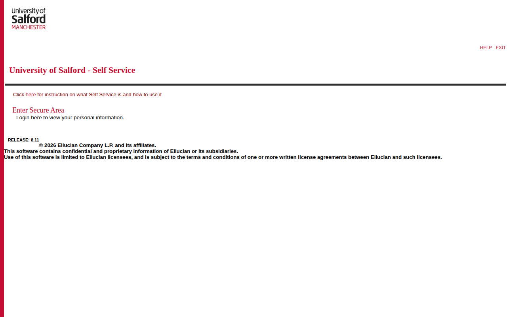
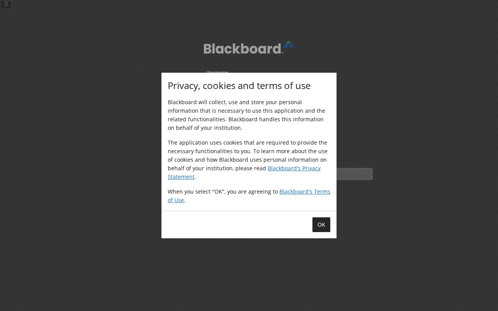
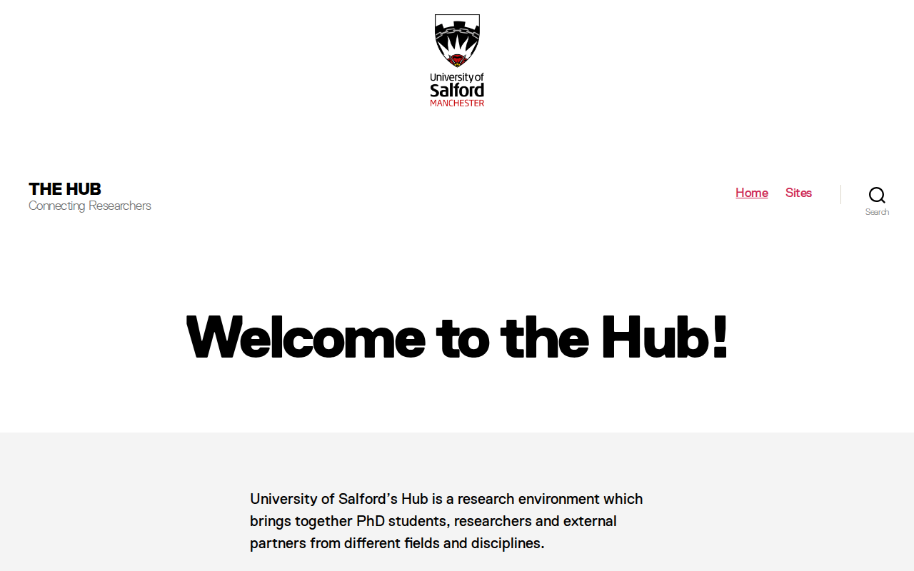
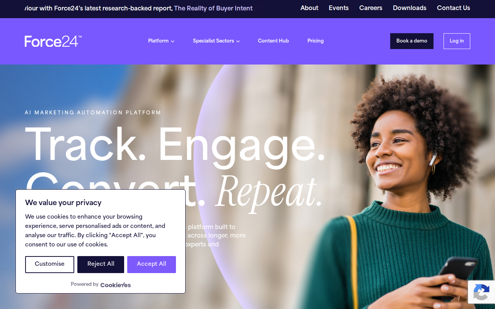
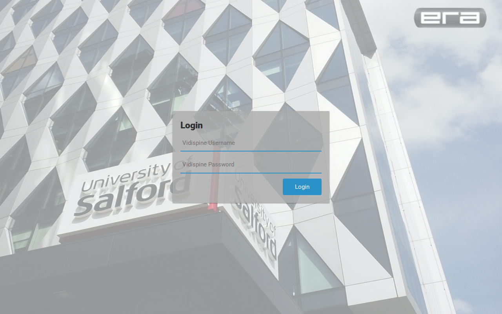
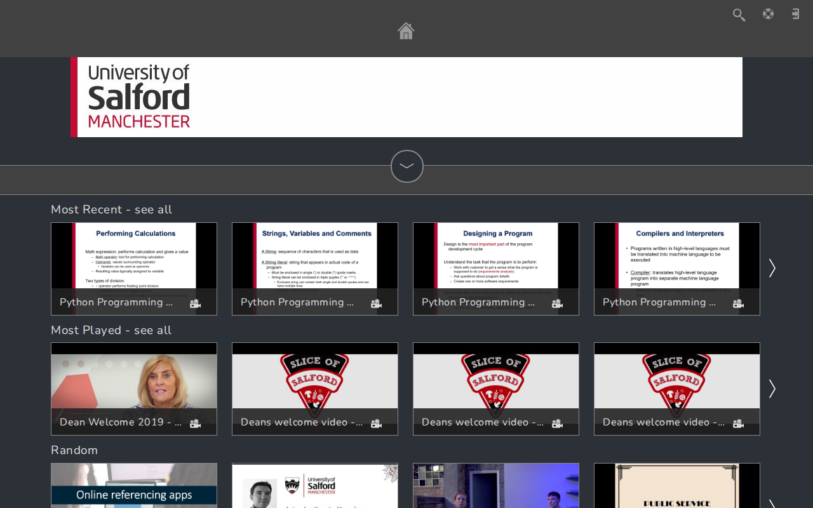
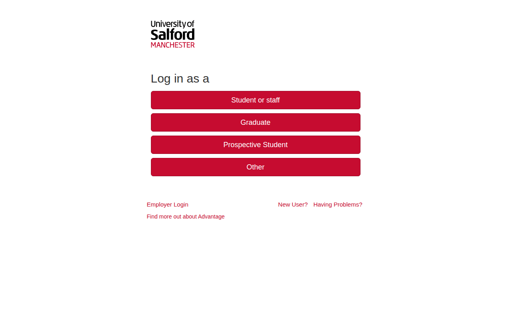
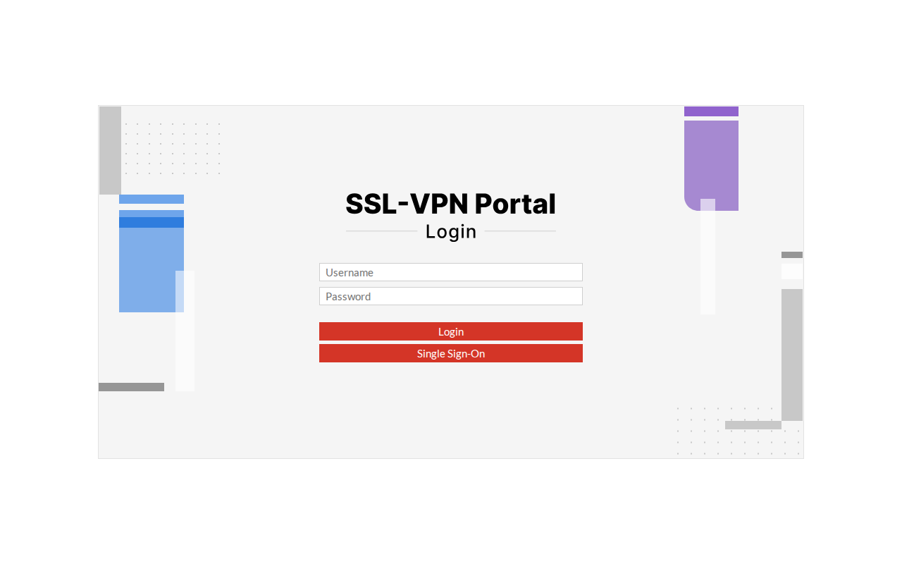
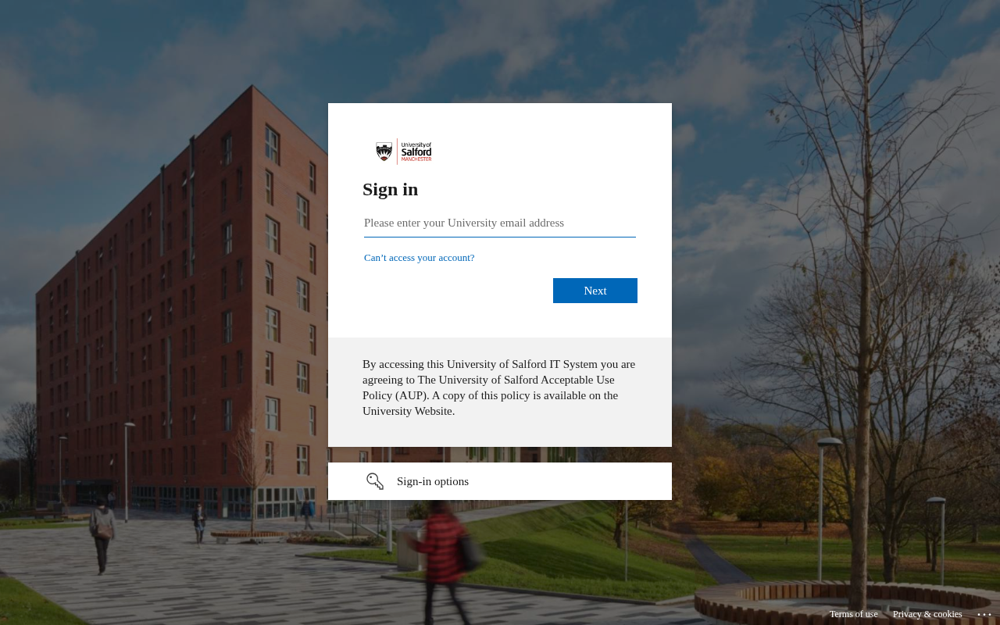
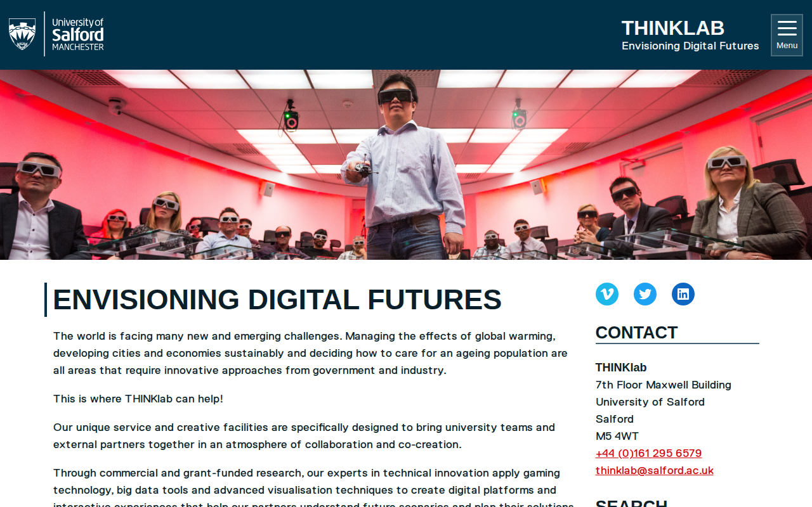

# salford.ac.uk — 18.10.2026

[← salford.ac.uk](../) &middot; [← All domains](../../)

Subdomains queried from [crt.sh](https://crt.sh/?q=%.salford.ac.uk).

## Summary

| Metric | Count |
|-------:|------:|
| Total subdomains found | 1074 |
| Online | 26 |
| ERR_CONNECTION_REFUSED | 717 |
| ERR_CONNECTION_RESET | 7 |
| ERR_NAME_NOT_RESOLVED | 130 |
| HTTP 403 | 1 |
| HTTP 404 | 1 |
| HTTP 502 | 1 |
| HTTP 503 | 2 |
| timeout | 189 |

## Online Subdomains

| Subdomain | Certificate Expires | Screenshot |
|-----------|---------------------|-----------|
| `assets.email.force24.salford.ac.uk` | `2022-05-12` |  |
| `bannerss.salford.ac.uk` | `2017-09-01` |  |
| `blackboard-uat.salford.ac.uk` | `2022-07-22` |  |
| `blackboard.salford.ac.uk` | `2022-06-25` |  |
| `email.force24.salford.ac.uk` | `2022-05-12` |  |
| `explore.salford.ac.uk` | `2022-04-15` |  |
| `fundus.salford.ac.uk` | `2022-04-24` |  |
| `hub.salford.ac.uk` | `2015-06-27` |  |
| `inplace-dev.salford.ac.uk` | `2022-01-27` |  |
| `inplace.salford.ac.uk` | `2022-12-27` |  |
| `landing.force24.salford.ac.uk` | `2022-04-01` |  |
| `mam.salford.ac.uk` | `2022-01-06` |  |
| `media.salford.ac.uk` | `2022-06-02` |  |
| `mediaupload.salford.ac.uk` | `2022-06-02` |  |
| `myadvantage.salford.ac.uk` | `2018-09-08` |  |
| `notrack.email.force24.salford.ac.uk` | `2022-05-12` |  |
| `remote.salford.ac.uk` | `2022-03-25` |  |
| `remotehub.salford.ac.uk` | `2022-03-25` |  |
| `remotehubtest.salford.ac.uk` | `2022-04-06` |  |
| `salford.ac.uk` | `2022-02-12` |  |
| `shop.salford.ac.uk` | `2022-05-05` |  |
| `showcase.salford.ac.uk` | `2022-09-30` |  |
| `staging.force24.salford.ac.uk` | `2022-04-02` |  |
| `thinklab.salford.ac.uk` | `2021-12-13` |  |
| `www.fundus.salford.ac.uk` | `2022-04-24` |  |
| `www.salford.ac.uk` | `2022-01-18` |  |

## Other Results

| Subdomain | Certificate Expires | Status |
|-----------|---------------------|--------|
| `aaa44469.muse.salford.ac.uk` | `2021-05-19` | `timeout` |
| `aaa44469.quays.salford.ac.uk` | `2022-05-11` | `timeout` |
| `abroad.salford.ac.uk` | `2015-06-27` | `ERR_CONNECTION_RESET` |
| `acs323.muse.salford.ac.uk` | `2022-02-09` | `timeout` |
| `acs323.poseidon.salford.ac.uk` | `2022-04-14` | `ERR_CONNECTION_REFUSED` |
| `acs323.quays.salford.ac.uk` | `2022-03-28` | `timeout` |
| `activesync.salford.ac.uk` | `2012-07-26` | `timeout` |
| `admin.aaa44469.muse.salford.ac.uk` | `2021-05-19` | `timeout` |
| `admin.aaa44469.quays.salford.ac.uk` | `2022-05-11` | `timeout` |
| `admin.acs323.muse.salford.ac.uk` | `2022-02-09` | `timeout` |
| `admin.acs323.poseidon.salford.ac.uk` | `2022-04-14` | `ERR_CONNECTION_REFUSED` |
| `admin.acs323.quays.salford.ac.uk` | `2022-03-28` | `timeout` |
| `admin.ads534.muse.salford.ac.uk` | `2021-06-08` | `timeout` |
| `admin.aee366.poseidon.salford.ac.uk` | `2022-04-04` | `ERR_CONNECTION_REFUSED` |
| `admin.aee420.poseidon.salford.ac.uk` | `2022-05-14` | `ERR_CONNECTION_REFUSED` |
| `admin.aee432.poseidon.salford.ac.uk` | `2022-04-16` | `ERR_CONNECTION_REFUSED` |
| `admin.aee650.poseidon.salford.ac.uk` | `2022-04-02` | `ERR_CONNECTION_REFUSED` |
| `admin.aee660.poseidon.salford.ac.uk` | `2022-05-15` | `ERR_CONNECTION_REFUSED` |
| `admin.aee673.muse.salford.ac.uk` | `2021-11-18` | `timeout` |
| `admin.agd623.poseidon.salford.ac.uk` | `2022-05-15` | `ERR_CONNECTION_REFUSED` |
| `admin.agd660.poseidon.salford.ac.uk` | `2022-04-11` | `ERR_CONNECTION_REFUSED` |
| `admin.agd691.poseidon.salford.ac.uk` | `2022-03-21` | `ERR_CONNECTION_REFUSED` |
| `admin.agd693.poseidon.salford.ac.uk` | `2022-03-21` | `ERR_CONNECTION_REFUSED` |
| `admin.agd705.poseidon.salford.ac.uk` | `2022-05-15` | `ERR_CONNECTION_REFUSED` |
| `admin.agd710.poseidon.salford.ac.uk` | `2022-05-15` | `ERR_CONNECTION_REFUSED` |
| `admin.agd717.poseidon.salford.ac.uk` | `2022-04-13` | `ERR_CONNECTION_REFUSED` |
| `admin.agd722.poseidon.salford.ac.uk` | `2022-05-08` | `ERR_CONNECTION_REFUSED` |
| `admin.agd746.poseidon.salford.ac.uk` | `2022-03-21` | `ERR_CONNECTION_REFUSED` |
| `admin.agd748.poseidon.salford.ac.uk` | `2022-04-11` | `ERR_CONNECTION_REFUSED` |
| `admin.agd785.poseidon.salford.ac.uk` | `2022-05-15` | `ERR_CONNECTION_REFUSED` |
| `admin.agd787.poseidon.salford.ac.uk` | `2022-05-15` | `ERR_CONNECTION_REFUSED` |
| `admin.agd791.poseidon.salford.ac.uk` | `2022-04-16` | `ERR_CONNECTION_REFUSED` |
| `admin.agd812.poseidon.salford.ac.uk` | `2022-04-11` | `ERR_CONNECTION_REFUSED` |
| `admin.agd825.poseidon.salford.ac.uk` | `2022-05-15` | `ERR_CONNECTION_REFUSED` |
| `admin.agd835.poseidon.salford.ac.uk` | `2022-04-13` | `ERR_CONNECTION_REFUSED` |
| `admin.agd851.poseidon.salford.ac.uk` | `2022-05-10` | `ERR_CONNECTION_REFUSED` |
| `admin.agd870.poseidon.salford.ac.uk` | `2022-03-28` | `ERR_CONNECTION_REFUSED` |
| `admin.agd871.poseidon.salford.ac.uk` | `2022-04-24` | `ERR_CONNECTION_REFUSED` |
| `admin.agd876.poseidon.salford.ac.uk` | `2022-05-15` | `ERR_CONNECTION_REFUSED` |
| `admin.agd896.poseidon.salford.ac.uk` | `2022-05-15` | `ERR_CONNECTION_REFUSED` |
| `admin.agd911.poseidon.salford.ac.uk` | `2022-04-05` | `ERR_CONNECTION_REFUSED` |
| `admin.agd923.poseidon.salford.ac.uk` | `2022-05-15` | `ERR_CONNECTION_REFUSED` |
| `admin.agd924.poseidon.salford.ac.uk` | `2022-05-15` | `ERR_CONNECTION_REFUSED` |
| `admin.agd927.poseidon.salford.ac.uk` | `2022-04-04` | `ERR_CONNECTION_REFUSED` |
| `admin.agd933.poseidon.salford.ac.uk` | `2022-05-06` | `ERR_CONNECTION_REFUSED` |
| `admin.agd937.poseidon.salford.ac.uk` | `2022-05-15` | `ERR_CONNECTION_REFUSED` |
| `admin.agd938.poseidon.salford.ac.uk` | `2022-04-11` | `ERR_CONNECTION_REFUSED` |
| `admin.agd940.poseidon.salford.ac.uk` | `2022-05-15` | `ERR_CONNECTION_REFUSED` |
| `admin.agd944.poseidon.salford.ac.uk` | `2022-05-15` | `ERR_CONNECTION_REFUSED` |
| `admin.agd962.poseidon.salford.ac.uk` | `2022-05-15` | `ERR_CONNECTION_REFUSED` |
| `admin.agd976.poseidon.salford.ac.uk` | `2022-04-13` | `ERR_CONNECTION_REFUSED` |
| `admin.agd991.poseidon.salford.ac.uk` | `2022-03-14` | `ERR_CONNECTION_REFUSED` |
| `admin.age006.poseidon.salford.ac.uk` | `2022-05-15` | `ERR_CONNECTION_REFUSED` |
| `admin.age007.poseidon.salford.ac.uk` | `2022-04-16` | `ERR_CONNECTION_REFUSED` |
| `admin.age378.poseidon.salford.ac.uk` | `2022-05-15` | `ERR_CONNECTION_REFUSED` |
| `admin.age419.poseidon.salford.ac.uk` | `2022-04-13` | `ERR_CONNECTION_REFUSED` |
| `admin.age479.poseidon.salford.ac.uk` | `2022-05-15` | `ERR_CONNECTION_REFUSED` |
| `admin.age511.poseidon.salford.ac.uk` | `2022-04-13` | `ERR_CONNECTION_REFUSED` |
| `admin.age608.poseidon.salford.ac.uk` | `2022-04-11` | `ERR_CONNECTION_REFUSED` |
| `admin.age612.poseidon.salford.ac.uk` | `2022-05-15` | `ERR_CONNECTION_REFUSED` |
| `admin.age668.poseidon.salford.ac.uk` | `2022-05-15` | `ERR_CONNECTION_REFUSED` |
| `admin.age677.poseidon.salford.ac.uk` | `2022-04-13` | `ERR_CONNECTION_REFUSED` |
| `admin.age724.poseidon.salford.ac.uk` | `2022-05-15` | `ERR_CONNECTION_REFUSED` |
| `admin.age729.poseidon.salford.ac.uk` | `2022-05-15` | `ERR_CONNECTION_REFUSED` |
| `admin.age780.poseidon.salford.ac.uk` | `2022-03-21` | `ERR_CONNECTION_REFUSED` |
| `admin.age807.poseidon.salford.ac.uk` | `2022-04-13` | `ERR_CONNECTION_REFUSED` |
| `admin.age813.poseidon.salford.ac.uk` | `2022-04-13` | `ERR_CONNECTION_REFUSED` |
| `admin.age814.poseidon.salford.ac.uk` | `2022-04-16` | `ERR_CONNECTION_REFUSED` |
| `admin.age835.poseidon.salford.ac.uk` | `2022-04-13` | `ERR_CONNECTION_REFUSED` |
| `admin.age867.poseidon.salford.ac.uk` | `2022-04-13` | `ERR_CONNECTION_REFUSED` |
| `admin.age868.poseidon.salford.ac.uk` | `2022-05-10` | `ERR_CONNECTION_REFUSED` |
| `admin.age873.poseidon.salford.ac.uk` | `2022-04-13` | `ERR_CONNECTION_REFUSED` |
| `admin.age916.poseidon.salford.ac.uk` | `2022-04-13` | `ERR_CONNECTION_REFUSED` |
| `admin.age929.poseidon.salford.ac.uk` | `2022-04-16` | `ERR_CONNECTION_REFUSED` |
| `admin.age979.poseidon.salford.ac.uk` | `2022-04-13` | `ERR_CONNECTION_REFUSED` |
| `admin.agg424.poseidon.salford.ac.uk` | `2022-04-13` | `ERR_CONNECTION_REFUSED` |
| `admin.agg465.poseidon.salford.ac.uk` | `2022-04-13` | `ERR_CONNECTION_REFUSED` |
| `admin.agg485.poseidon.salford.ac.uk` | `2022-04-13` | `ERR_CONNECTION_REFUSED` |
| `admin.agg568.poseidon.salford.ac.uk` | `2022-04-13` | `ERR_CONNECTION_REFUSED` |
| `admin.agg598.poseidon.salford.ac.uk` | `2022-04-16` | `ERR_CONNECTION_REFUSED` |
| `admin.agg609.poseidon.salford.ac.uk` | `2022-04-13` | `ERR_CONNECTION_REFUSED` |
| `admin.agg614.poseidon.salford.ac.uk` | `2022-04-13` | `ERR_CONNECTION_REFUSED` |
| `admin.agg622.poseidon.salford.ac.uk` | `2022-04-13` | `ERR_CONNECTION_REFUSED` |
| `admin.agg654.poseidon.salford.ac.uk` | `2022-04-16` | `ERR_CONNECTION_REFUSED` |
| `admin.agg655.poseidon.salford.ac.uk` | `2022-04-13` | `ERR_CONNECTION_REFUSED` |
| `admin.agg683.poseidon.salford.ac.uk` | `2022-04-16` | `ERR_CONNECTION_REFUSED` |
| `admin.agg774.poseidon.salford.ac.uk` | `2022-04-16` | `ERR_CONNECTION_REFUSED` |
| `admin.agg785.poseidon.salford.ac.uk` | `2022-04-13` | `ERR_CONNECTION_REFUSED` |
| `admin.agg802.poseidon.salford.ac.uk` | `2022-04-13` | `ERR_CONNECTION_REFUSED` |
| `admin.agg804.poseidon.salford.ac.uk` | `2022-04-13` | `ERR_CONNECTION_REFUSED` |
| `admin.agg811.poseidon.salford.ac.uk` | `2022-04-13` | `ERR_CONNECTION_REFUSED` |
| `admin.agg860.poseidon.salford.ac.uk` | `2022-04-16` | `ERR_CONNECTION_REFUSED` |
| `admin.agg875.poseidon.salford.ac.uk` | `2022-04-13` | `ERR_CONNECTION_REFUSED` |
| `admin.agg893.poseidon.salford.ac.uk` | `2022-04-13` | `ERR_CONNECTION_REFUSED` |
| `admin.agg903.poseidon.salford.ac.uk` | `2022-04-16` | `ERR_CONNECTION_REFUSED` |
| `admin.agg936.poseidon.salford.ac.uk` | `2022-04-16` | `ERR_CONNECTION_REFUSED` |
| `admin.agg941.poseidon.salford.ac.uk` | `2022-04-13` | `ERR_CONNECTION_REFUSED` |
| `admin.btc698.poseidon.salford.ac.uk` | `2022-05-15` | `ERR_CONNECTION_REFUSED` |
| `admin.dtest.poseidon.salford.ac.uk` | `2021-04-19` | `ERR_CONNECTION_REFUSED` |
| `admin.four.quays.salford.ac.uk` | `2021-12-14` | `timeout` |
| `admin.hc21-7.poseidon.salford.ac.uk` | `2022-03-28` | `ERR_CONNECTION_REFUSED` |
| `admin.hc22-1.poseidon.salford.ac.uk` | `2022-04-11` | `ERR_CONNECTION_REFUSED` |
| `admin.hc22-10.poseidon.salford.ac.uk` | `2022-04-10` | `ERR_CONNECTION_REFUSED` |
| `admin.hc22-11.poseidon.salford.ac.uk` | `2022-04-12` | `ERR_CONNECTION_REFUSED` |
| `admin.hc22-13.poseidon.salford.ac.uk` | `2022-04-12` | `ERR_CONNECTION_REFUSED` |
| `admin.hc22-14.poseidon.salford.ac.uk` | `2022-04-10` | `ERR_CONNECTION_REFUSED` |
| `admin.hc22-16.poseidon.salford.ac.uk` | `2022-04-10` | `ERR_CONNECTION_REFUSED` |
| `admin.hc22-17.poseidon.salford.ac.uk` | `2022-04-10` | `ERR_CONNECTION_REFUSED` |
| `admin.hc22-18.poseidon.salford.ac.uk` | `2022-04-10` | `ERR_CONNECTION_REFUSED` |
| `admin.hc22-2.poseidon.salford.ac.uk` | `2022-04-12` | `ERR_CONNECTION_REFUSED` |
| `admin.hc22-22.poseidon.salford.ac.uk` | `2022-04-10` | `ERR_CONNECTION_REFUSED` |
| `admin.hc22-23.poseidon.salford.ac.uk` | `2022-04-11` | `ERR_CONNECTION_REFUSED` |
| `admin.hc22-24.poseidon.salford.ac.uk` | `2022-04-10` | `ERR_CONNECTION_REFUSED` |
| `admin.hc22-3.poseidon.salford.ac.uk` | `2022-04-10` | `ERR_CONNECTION_REFUSED` |
| `admin.hc22-4.poseidon.salford.ac.uk` | `2022-04-10` | `ERR_CONNECTION_REFUSED` |
| `admin.hc22-5.poseidon.salford.ac.uk` | `2022-04-11` | `ERR_CONNECTION_REFUSED` |
| `admin.hc22-6.poseidon.salford.ac.uk` | `2022-04-10` | `ERR_CONNECTION_REFUSED` |
| `admin.hc22-8.poseidon.salford.ac.uk` | `2022-04-12` | `ERR_CONNECTION_REFUSED` |
| `admin.hc22-9.poseidon.salford.ac.uk` | `2022-04-10` | `ERR_CONNECTION_REFUSED` |
| `admin.lab527.poseidon.salford.ac.uk` | `2022-05-15` | `ERR_CONNECTION_REFUSED` |
| `admin.lab570.poseidon.salford.ac.uk` | `2022-04-13` | `ERR_CONNECTION_REFUSED` |
| `admin.lab591.poseidon.salford.ac.uk` | `2022-04-13` | `ERR_CONNECTION_REFUSED` |
| `admin.lab594.poseidon.salford.ac.uk` | `2022-04-13` | `ERR_CONNECTION_REFUSED` |
| `admin.lab623.poseidon.salford.ac.uk` | `2022-04-13` | `ERR_CONNECTION_REFUSED` |
| `admin.lab629.poseidon.salford.ac.uk` | `2022-04-13` | `ERR_CONNECTION_REFUSED` |
| `admin.lab660.poseidon.salford.ac.uk` | `2022-04-13` | `ERR_CONNECTION_REFUSED` |
| `admin.lab662.poseidon.salford.ac.uk` | `2022-04-13` | `ERR_CONNECTION_REFUSED` |
| `admin.lab664.poseidon.salford.ac.uk` | `2022-04-13` | `ERR_CONNECTION_REFUSED` |
| `admin.lagd722.poseidon.salford.ac.uk` | `2021-12-28` | `ERR_CONNECTION_REFUSED` |
| `admin.lwa232.poseidon.salford.ac.uk` | `2022-04-13` | `ERR_CONNECTION_REFUSED` |
| `admin.lza403.poseidon.salford.ac.uk` | `2022-05-13` | `ERR_CONNECTION_REFUSED` |
| `admin.media.quays.salford.ac.uk` | `2022-03-22` | `timeout` |
| `admin.mee123.poseidon.salford.ac.uk` | `2021-10-30` | `ERR_CONNECTION_REFUSED` |
| `admin.mmb984.poseidon.salford.ac.uk` | `2021-12-26` | `ERR_CONNECTION_REFUSED` |
| `admin.mmf834.muse.salford.ac.uk` | `2021-11-18` | `timeout` |
| `admin.mmf834.quays.salford.ac.uk` | `2021-12-14` | `timeout` |
| `admin.mmn601.muse.salford.ac.uk` | `2021-09-17` | `timeout` |
| `admin.mua377.muse.salford.ac.uk` | `2021-11-25` | `timeout` |
| `admin.mua546.muse.salford.ac.uk` | `2021-09-17` | `timeout` |
| `admin.mua547.muse.salford.ac.uk` | `2021-11-25` | `timeout` |
| `admin.mua553.muse.salford.ac.uk` | `2021-09-17` | `timeout` |
| `admin.mua624.muse.salford.ac.uk` | `2021-09-17` | `timeout` |
| `admin.mua636.muse.salford.ac.uk` | `2021-09-17` | `timeout` |
| `admin.mua838.muse.salford.ac.uk` | `2021-09-17` | `timeout` |
| `admin.mua886.muse.salford.ac.uk` | `2021-09-17` | `timeout` |
| `admin.mua937.muse.salford.ac.uk` | `2021-09-17` | `timeout` |
| `admin.mua937l.muse.salford.ac.uk` | `2021-01-19` | `timeout` |
| `admin.muc003.muse.salford.ac.uk` | `2021-11-18` | `timeout` |
| `admin.muc285.muse.salford.ac.uk` | `2021-09-17` | `timeout` |
| `admin.muc438.muse.salford.ac.uk` | `2021-09-17` | `timeout` |
| `admin.muc458.muse.salford.ac.uk` | `2021-09-17` | `timeout` |
| `admin.muc879.quays.salford.ac.uk` | `2022-03-12` | `timeout` |
| `admin.muj181.quays.salford.ac.uk` | `2022-03-26` | `timeout` |
| `admin.muse.salford.ac.uk` | `2022-03-21` | `timeout` |
| `admin.pmf948.poseidon.salford.ac.uk` | `2022-04-16` | `ERR_CONNECTION_REFUSED` |
| `admin.quays.salford.ac.uk` | `2022-05-01` | `timeout` |
| `admin.quaystv.muse.salford.ac.uk` | `2021-01-19` | `timeout` |
| `admin.redux.quays.salford.ac.uk` | `2021-09-19` | `timeout` |
| `admin.sap787.poseidon.salford.ac.uk` | `2022-04-21` | `ERR_CONNECTION_REFUSED` |
| `admin.sap799.poseidon.salford.ac.uk` | `2021-12-29` | `ERR_CONNECTION_REFUSED` |
| `admin.sap810.poseidon.salford.ac.uk` | `2022-05-06` | `ERR_CONNECTION_REFUSED` |
| `admin.sap990.poseidon.salford.ac.uk` | `2022-01-16` | `ERR_CONNECTION_REFUSED` |
| `admin.sbp013.poseidon.salford.ac.uk` | `2021-12-26` | `ERR_CONNECTION_REFUSED` |
| `admin.sbp017.poseidon.salford.ac.uk` | `2022-01-16` | `ERR_CONNECTION_REFUSED` |
| `admin.sbp108.poseidon.salford.ac.uk` | `2022-05-08` | `ERR_CONNECTION_REFUSED` |
| `admin.sbp240.poseidon.salford.ac.uk` | `2022-03-26` | `ERR_CONNECTION_REFUSED` |
| `admin.sgb112.poseidon.salford.ac.uk` | `2022-01-16` | `ERR_CONNECTION_REFUSED` |
| `admin.sgb175.poseidon.salford.ac.uk` | `2022-05-15` | `ERR_CONNECTION_REFUSED` |
| `admin.sgb207.poseidon.salford.ac.uk` | `2021-11-26` | `ERR_CONNECTION_REFUSED` |
| `admin.sgb346.poseidon.salford.ac.uk` | `2021-12-11` | `ERR_CONNECTION_REFUSED` |
| `admin.sgb573.poseidon.salford.ac.uk` | `2021-07-21` | `ERR_CONNECTION_REFUSED` |
| `admin.sgb588.poseidon.salford.ac.uk` | `2022-05-14` | `ERR_CONNECTION_REFUSED` |
| `admin.sgb791.poseidon.salford.ac.uk` | `2022-05-15` | `ERR_CONNECTION_REFUSED` |
| `admin.sgl491.poseidon.salford.ac.uk` | `2022-03-26` | `ERR_CONNECTION_REFUSED` |
| `admin.sjp085.poseidon.salford.ac.uk` | `2022-01-16` | `ERR_CONNECTION_REFUSED` |
| `admin.stb849.poseidon.salford.ac.uk` | `2022-03-26` | `ERR_CONNECTION_REFUSED` |
| `admin.stc714.poseidon.salford.ac.uk` | `2022-01-14` | `ERR_CONNECTION_REFUSED` |
| `admin.stc802.poseidon.salford.ac.uk` | `2021-11-24` | `ERR_CONNECTION_REFUSED` |
| `admin.sye608.poseidon.salford.ac.uk` | `2022-05-15` | `ERR_CONNECTION_REFUSED` |
| `admin.test.muse.salford.ac.uk` | `2022-05-11` | `timeout` |
| `admin.test1.muse.salford.ac.uk` | `2021-01-17` | `timeout` |
| `admin.three.quays.salford.ac.uk` | `2021-12-14` | `timeout` |
| `admin.wp.quays.salford.ac.uk` | `2022-04-09` | `timeout` |
| `admin.zzz123.muse.salford.ac.uk` | `2021-05-10` | `timeout` |
| `ads534.muse.salford.ac.uk` | `2021-06-08` | `timeout` |
| `aee366.poseidon.salford.ac.uk` | `2022-04-04` | `ERR_CONNECTION_REFUSED` |
| `aee420.poseidon.salford.ac.uk` | `2022-05-14` | `ERR_CONNECTION_REFUSED` |
| `aee432.poseidon.salford.ac.uk` | `2022-04-16` | `ERR_CONNECTION_REFUSED` |
| `aee650.poseidon.salford.ac.uk` | `2022-04-02` | `ERR_CONNECTION_REFUSED` |
| `aee660.poseidon.salford.ac.uk` | `2022-05-15` | `ERR_CONNECTION_REFUSED` |
| `aee673.muse.salford.ac.uk` | `2021-11-18` | `timeout` |
| `aee766.poseidon.salford.ac.uk` | `2022-04-02` | `ERR_CONNECTION_REFUSED` |
| `agd623.poseidon.salford.ac.uk` | `2022-05-15` | `ERR_CONNECTION_REFUSED` |
| `agd660.poseidon.salford.ac.uk` | `2022-04-11` | `ERR_CONNECTION_REFUSED` |
| `agd691.poseidon.salford.ac.uk` | `2022-03-21` | `ERR_CONNECTION_REFUSED` |
| `agd693.poseidon.salford.ac.uk` | `2022-03-21` | `ERR_CONNECTION_REFUSED` |
| `agd705.poseidon.salford.ac.uk` | `2022-05-15` | `ERR_CONNECTION_REFUSED` |
| `agd710.poseidon.salford.ac.uk` | `2022-05-15` | `ERR_CONNECTION_REFUSED` |
| `agd717.poseidon.salford.ac.uk` | `2022-04-13` | `ERR_CONNECTION_REFUSED` |
| `agd722.poseidon.salford.ac.uk` | `2022-05-08` | `ERR_CONNECTION_REFUSED` |
| `agd746.poseidon.salford.ac.uk` | `2022-03-21` | `ERR_CONNECTION_REFUSED` |
| `agd748.poseidon.salford.ac.uk` | `2022-04-11` | `ERR_CONNECTION_REFUSED` |
| `agd785.poseidon.salford.ac.uk` | `2022-05-15` | `ERR_CONNECTION_REFUSED` |
| `agd787.poseidon.salford.ac.uk` | `2022-05-15` | `ERR_CONNECTION_REFUSED` |
| `agd791.poseidon.salford.ac.uk` | `2022-04-16` | `ERR_CONNECTION_REFUSED` |
| `agd812.poseidon.salford.ac.uk` | `2022-04-11` | `ERR_CONNECTION_REFUSED` |
| `agd825.poseidon.salford.ac.uk` | `2022-05-15` | `ERR_CONNECTION_REFUSED` |
| `agd835.poseidon.salford.ac.uk` | `2022-04-13` | `ERR_CONNECTION_REFUSED` |
| `agd851.poseidon.salford.ac.uk` | `2022-05-10` | `ERR_CONNECTION_REFUSED` |
| `agd870.poseidon.salford.ac.uk` | `2022-03-28` | `ERR_CONNECTION_REFUSED` |
| `agd871.poseidon.salford.ac.uk` | `2022-04-24` | `ERR_CONNECTION_REFUSED` |
| `agd876.poseidon.salford.ac.uk` | `2022-05-15` | `ERR_CONNECTION_REFUSED` |
| `agd896.poseidon.salford.ac.uk` | `2022-05-15` | `ERR_CONNECTION_REFUSED` |
| `agd911.poseidon.salford.ac.uk` | `2022-04-05` | `ERR_CONNECTION_REFUSED` |
| `agd923.poseidon.salford.ac.uk` | `2022-05-15` | `ERR_CONNECTION_REFUSED` |
| `agd924.poseidon.salford.ac.uk` | `2022-05-15` | `ERR_CONNECTION_REFUSED` |
| `agd927.poseidon.salford.ac.uk` | `2022-04-04` | `ERR_CONNECTION_REFUSED` |
| `agd933.poseidon.salford.ac.uk` | `2022-05-06` | `ERR_CONNECTION_REFUSED` |
| `agd937.poseidon.salford.ac.uk` | `2022-05-15` | `ERR_CONNECTION_REFUSED` |
| `agd938.poseidon.salford.ac.uk` | `2022-04-11` | `ERR_CONNECTION_REFUSED` |
| `agd940.poseidon.salford.ac.uk` | `2022-05-15` | `ERR_CONNECTION_REFUSED` |
| `agd944.poseidon.salford.ac.uk` | `2022-05-15` | `ERR_CONNECTION_REFUSED` |
| `agd962.poseidon.salford.ac.uk` | `2022-05-15` | `ERR_CONNECTION_REFUSED` |
| `agd976.poseidon.salford.ac.uk` | `2022-04-13` | `ERR_CONNECTION_REFUSED` |
| `agd991.poseidon.salford.ac.uk` | `2022-03-14` | `ERR_CONNECTION_REFUSED` |
| `age004.poseidon.salford.ac.uk` | `2022-03-12` | `ERR_CONNECTION_REFUSED` |
| `age006.poseidon.salford.ac.uk` | `2022-05-15` | `ERR_CONNECTION_REFUSED` |
| `age007.poseidon.salford.ac.uk` | `2022-04-16` | `ERR_CONNECTION_REFUSED` |
| `age378.poseidon.salford.ac.uk` | `2022-05-15` | `ERR_CONNECTION_REFUSED` |
| `age419.poseidon.salford.ac.uk` | `2022-04-13` | `ERR_CONNECTION_REFUSED` |
| `age479.poseidon.salford.ac.uk` | `2022-05-15` | `ERR_CONNECTION_REFUSED` |
| `age511.poseidon.salford.ac.uk` | `2022-04-13` | `ERR_CONNECTION_REFUSED` |
| `age608.poseidon.salford.ac.uk` | `2022-04-11` | `ERR_CONNECTION_REFUSED` |
| `age612.poseidon.salford.ac.uk` | `2022-05-15` | `ERR_CONNECTION_REFUSED` |
| `age668.poseidon.salford.ac.uk` | `2022-05-15` | `ERR_CONNECTION_REFUSED` |
| `age677.poseidon.salford.ac.uk` | `2022-04-13` | `ERR_CONNECTION_REFUSED` |
| `age724.poseidon.salford.ac.uk` | `2022-05-15` | `ERR_CONNECTION_REFUSED` |
| `age729.poseidon.salford.ac.uk` | `2022-05-15` | `ERR_CONNECTION_REFUSED` |
| `age780.poseidon.salford.ac.uk` | `2022-03-21` | `ERR_CONNECTION_REFUSED` |
| `age807.poseidon.salford.ac.uk` | `2022-04-13` | `ERR_CONNECTION_REFUSED` |
| `age813.poseidon.salford.ac.uk` | `2022-04-13` | `ERR_CONNECTION_REFUSED` |
| `age814.poseidon.salford.ac.uk` | `2022-04-16` | `ERR_CONNECTION_REFUSED` |
| `age835.poseidon.salford.ac.uk` | `2022-04-13` | `ERR_CONNECTION_REFUSED` |
| `age867.poseidon.salford.ac.uk` | `2022-04-13` | `ERR_CONNECTION_REFUSED` |
| `age868.poseidon.salford.ac.uk` | `2022-05-10` | `ERR_CONNECTION_REFUSED` |
| `age873.poseidon.salford.ac.uk` | `2022-04-13` | `ERR_CONNECTION_REFUSED` |
| `age916.poseidon.salford.ac.uk` | `2022-04-13` | `ERR_CONNECTION_REFUSED` |
| `age929.poseidon.salford.ac.uk` | `2022-04-16` | `ERR_CONNECTION_REFUSED` |
| `age979.poseidon.salford.ac.uk` | `2022-04-13` | `ERR_CONNECTION_REFUSED` |
| `agg424.poseidon.salford.ac.uk` | `2022-04-13` | `ERR_CONNECTION_REFUSED` |
| `agg465.poseidon.salford.ac.uk` | `2022-04-13` | `ERR_CONNECTION_REFUSED` |
| `agg485.poseidon.salford.ac.uk` | `2022-04-13` | `ERR_CONNECTION_REFUSED` |
| `agg568.poseidon.salford.ac.uk` | `2022-04-13` | `ERR_CONNECTION_REFUSED` |
| `agg598.poseidon.salford.ac.uk` | `2022-04-16` | `ERR_CONNECTION_REFUSED` |
| `agg609.poseidon.salford.ac.uk` | `2022-04-13` | `ERR_CONNECTION_REFUSED` |
| `agg614.poseidon.salford.ac.uk` | `2022-04-13` | `ERR_CONNECTION_REFUSED` |
| `agg622.poseidon.salford.ac.uk` | `2022-04-13` | `ERR_CONNECTION_REFUSED` |
| `agg654.poseidon.salford.ac.uk` | `2022-04-16` | `ERR_CONNECTION_REFUSED` |
| `agg655.poseidon.salford.ac.uk` | `2022-04-13` | `ERR_CONNECTION_REFUSED` |
| `agg683.poseidon.salford.ac.uk` | `2022-04-16` | `ERR_CONNECTION_REFUSED` |
| `agg774.poseidon.salford.ac.uk` | `2022-04-16` | `ERR_CONNECTION_REFUSED` |
| `agg785.poseidon.salford.ac.uk` | `2022-04-13` | `ERR_CONNECTION_REFUSED` |
| `agg802.poseidon.salford.ac.uk` | `2022-04-13` | `ERR_CONNECTION_REFUSED` |
| `agg804.poseidon.salford.ac.uk` | `2022-04-13` | `ERR_CONNECTION_REFUSED` |
| `agg811.poseidon.salford.ac.uk` | `2022-04-13` | `ERR_CONNECTION_REFUSED` |
| `agg860.poseidon.salford.ac.uk` | `2022-04-16` | `ERR_CONNECTION_REFUSED` |
| `agg875.poseidon.salford.ac.uk` | `2022-04-13` | `ERR_CONNECTION_REFUSED` |
| `agg893.poseidon.salford.ac.uk` | `2022-04-13` | `ERR_CONNECTION_REFUSED` |
| `agg903.poseidon.salford.ac.uk` | `2022-04-16` | `ERR_CONNECTION_REFUSED` |
| `agg936.poseidon.salford.ac.uk` | `2022-04-16` | `ERR_CONNECTION_REFUSED` |
| `agg941.poseidon.salford.ac.uk` | `2022-04-13` | `ERR_CONNECTION_REFUSED` |
| `apply.accommodation.salford.ac.uk` | `2017-03-24` | `ERR_NAME_NOT_RESOLVED` |
| `artemis.cs.salford.ac.uk` | `2022-04-25` | `ERR_CONNECTION_RESET` |
| `ascent1.salford.ac.uk` | `2016-05-29` | `ERR_NAME_NOT_RESOLVED` |
| `auth2.salford.ac.uk` | `2022-06-23` | `ERR_NAME_NOT_RESOLVED` |
| `autodiscover.salford.ac.uk` | `2020-03-07` | `ERR_CONNECTION_REFUSED` |
| `basics.salford.ac.uk` | `2020-08-31` | `ERR_NAME_NOT_RESOLVED` |
| `bbsaas-uat.salford.ac.uk` | `2022-05-26` | `ERR_NAME_NOT_RESOLVED` |
| `btc698.poseidon.salford.ac.uk` | `2022-05-15` | `ERR_CONNECTION_REFUSED` |
| `byod.salford.ac.uk` | `2022-10-20` | `ERR_NAME_NOT_RESOLVED` |
| `cafm.salford.ac.uk` | `2015-11-08` | `timeout` |
| `ccx-all-x06-01.salford.ac.uk` | `2022-11-30` | `ERR_NAME_NOT_RESOLVED` |
| `ccx-cwb-b15-02.salford.ac.uk` | `2022-11-30` | `ERR_NAME_NOT_RESOLVED` |
| `cm-all-x06-05.salford.ac.uk` | `2021-04-24` | `ERR_NAME_NOT_RESOLVED` |
| `cm-all-x06-06.salford.ac.uk` | `2021-04-24` | `ERR_NAME_NOT_RESOLVED` |
| `cm-all-x06-07.salford.ac.uk` | `2021-04-24` | `ERR_NAME_NOT_RESOLVED` |
| `cm-cwb-b15-01.salford.ac.uk` | `2021-04-24` | `ERR_NAME_NOT_RESOLVED` |
| `cm-cwb-b15-02.salford.ac.uk` | `2021-04-24` | `ERR_NAME_NOT_RESOLVED` |
| `cm-cwb-b15-03.salford.ac.uk` | `2021-04-24` | `ERR_NAME_NOT_RESOLVED` |
| `cm-cwb-b15-04.salford.ac.uk` | `2021-04-24` | `ERR_NAME_NOT_RESOLVED` |
| `cpdstore.salford.ac.uk` | `2022-05-05` | `ERR_NAME_NOT_RESOLVED` |
| `crm.dev.salford.ac.uk` | `2012-03-25` | `ERR_NAME_NOT_RESOLVED` |
| `crm.salford.ac.uk` | `2012-04-14` | `timeout` |
| `crm.train.salford.ac.uk` | `2012-04-08` | `ERR_NAME_NOT_RESOLVED` |
| `cs.salford.ac.uk` | `2019-08-10` | `ERR_NAME_NOT_RESOLVED` |
| `cup-all-x06-02.salford.ac.uk` | `2021-04-24` | `ERR_NAME_NOT_RESOLVED` |
| `cup-cwb-b15-01.salford.ac.uk` | `2021-04-24` | `ERR_NAME_NOT_RESOLVED` |
| `dan.poseidon.salford.ac.uk` | `2022-03-21` | `ERR_CONNECTION_REFUSED` |
| `dap-campus.salford.ac.uk` | `2021-06-16` | `ERR_NAME_NOT_RESOLVED` |
| `demeter.cs.salford.ac.uk` | `2022-05-09` | `ERR_NAME_NOT_RESOLVED` |
| `dhssapi.salford.ac.uk` | `2022-04-19` | `timeout` |
| `dtest.poseidon.salford.ac.uk` | `2021-04-19` | `ERR_CONNECTION_REFUSED` |
| `eduroam.salford.ac.uk` | `2021-01-04` | `ERR_NAME_NOT_RESOLVED` |
| `elibrary.salford.ac.uk` | `2016-06-23` | `ERR_NAME_NOT_RESOLVED` |
| `emailarchive.salford.ac.uk` | `2011-08-06` | `timeout` |
| `ewc-all-x06-02.salford.ac.uk` | `2018-05-25` | `ERR_NAME_NOT_RESOLVED` |
| `ewc-cwb-b15-01.salford.ac.uk` | `2018-05-25` | `ERR_NAME_NOT_RESOLVED` |
| `ewe-all-x06-02.salford.ac.uk` | `2018-05-25` | `timeout` |
| `ewe-cwb-b15-01.salford.ac.uk` | `2018-05-25` | `timeout` |
| `fam-uat.salford.ac.uk` | `2017-05-05` | `ERR_NAME_NOT_RESOLVED` |
| `fam-uatproxy.salford.ac.uk` | `2020-06-04` | `ERR_NAME_NOT_RESOLVED` |
| `fam.salford.ac.uk` | `2018-07-28` | `ERR_NAME_NOT_RESOLVED` |
| `famproxy.salford.ac.uk` | `2019-09-18` | `ERR_NAME_NOT_RESOLVED` |
| `financials.salford.ac.uk` | `2012-10-06` | `ERR_CONNECTION_RESET` |
| `four.quays.salford.ac.uk` | `2021-12-14` | `timeout` |
| `fym.cse.salford.ac.uk` | `2013-10-26` | `ERR_CONNECTION_RESET` |
| `gitlab.cs.salford.ac.uk` | `2019-09-18` | `ERR_NAME_NOT_RESOLVED` |
| `guest.salford.ac.uk` | `2022-10-20` | `ERR_NAME_NOT_RESOLVED` |
| `hc21-7.poseidon.salford.ac.uk` | `2022-03-28` | `ERR_CONNECTION_REFUSED` |
| `hc22-1.poseidon.salford.ac.uk` | `2022-04-11` | `ERR_CONNECTION_REFUSED` |
| `hc22-10.poseidon.salford.ac.uk` | `2022-04-10` | `ERR_CONNECTION_REFUSED` |
| `hc22-11.poseidon.salford.ac.uk` | `2022-04-12` | `ERR_CONNECTION_REFUSED` |
| `hc22-13.poseidon.salford.ac.uk` | `2022-04-12` | `ERR_CONNECTION_REFUSED` |
| `hc22-14.poseidon.salford.ac.uk` | `2022-04-10` | `ERR_CONNECTION_REFUSED` |
| `hc22-15.poseidon.salford.ac.uk` | `2022-04-11` | `ERR_CONNECTION_REFUSED` |
| `hc22-16.poseidon.salford.ac.uk` | `2022-04-10` | `ERR_CONNECTION_REFUSED` |
| `hc22-17.poseidon.salford.ac.uk` | `2022-04-10` | `ERR_CONNECTION_REFUSED` |
| `hc22-18.poseidon.salford.ac.uk` | `2022-04-10` | `ERR_CONNECTION_REFUSED` |
| `hc22-2.poseidon.salford.ac.uk` | `2022-04-12` | `ERR_CONNECTION_REFUSED` |
| `hc22-22.poseidon.salford.ac.uk` | `2022-04-10` | `ERR_CONNECTION_REFUSED` |
| `hc22-23.poseidon.salford.ac.uk` | `2022-04-11` | `ERR_CONNECTION_REFUSED` |
| `hc22-24.poseidon.salford.ac.uk` | `2022-04-10` | `ERR_CONNECTION_REFUSED` |
| `hc22-3.poseidon.salford.ac.uk` | `2022-04-10` | `ERR_CONNECTION_REFUSED` |
| `hc22-4.poseidon.salford.ac.uk` | `2022-04-10` | `ERR_CONNECTION_REFUSED` |
| `hc22-5.poseidon.salford.ac.uk` | `2022-04-11` | `ERR_CONNECTION_REFUSED` |
| `hc22-6.poseidon.salford.ac.uk` | `2022-04-10` | `ERR_CONNECTION_REFUSED` |
| `hc22-8.poseidon.salford.ac.uk` | `2022-04-12` | `ERR_CONNECTION_REFUSED` |
| `hc22-9.poseidon.salford.ac.uk` | `2022-04-10` | `ERR_CONNECTION_REFUSED` |
| `helix-test.salford.ac.uk` | `2022-06-02` | `timeout` |
| `helix.salford.ac.uk` | `2022-06-02` | `timeout` |
| `hotspot.salford.ac.uk` | `2022-10-20` | `ERR_NAME_NOT_RESOLVED` |
| `ideas.salford.ac.uk` | `2019-11-30` | `ERR_NAME_NOT_RESOLVED` |
| `idm.salford.ac.uk` | `2016-02-11` | `timeout` |
| `inplacedev.salford.ac.uk` | `2021-06-14` | `ERR_NAME_NOT_RESOLVED` |
| `isdads.salford.ac.uk` | `2019-07-24` | `ERR_NAME_NOT_RESOLVED` |
| `lab527.poseidon.salford.ac.uk` | `2022-05-15` | `ERR_CONNECTION_REFUSED` |
| `lab570.poseidon.salford.ac.uk` | `2022-04-13` | `ERR_CONNECTION_REFUSED` |
| `lab591.poseidon.salford.ac.uk` | `2022-04-13` | `ERR_CONNECTION_REFUSED` |
| `lab594.poseidon.salford.ac.uk` | `2022-04-13` | `ERR_CONNECTION_REFUSED` |
| `lab623.poseidon.salford.ac.uk` | `2022-04-13` | `ERR_CONNECTION_REFUSED` |
| `lab629.poseidon.salford.ac.uk` | `2022-04-13` | `ERR_CONNECTION_REFUSED` |
| `lab660.poseidon.salford.ac.uk` | `2022-04-13` | `ERR_CONNECTION_REFUSED` |
| `lab662.poseidon.salford.ac.uk` | `2022-04-13` | `ERR_CONNECTION_REFUSED` |
| `lab664.poseidon.salford.ac.uk` | `2022-04-13` | `ERR_CONNECTION_REFUSED` |
| `lagd722.poseidon.salford.ac.uk` | `2021-12-28` | `ERR_CONNECTION_REFUSED` |
| `lasu.salford.ac.uk` | `2015-10-11` | `ERR_NAME_NOT_RESOLVED` |
| `ldap-campus.salford.ac.uk` | `2022-06-23` | `ERR_NAME_NOT_RESOLVED` |
| `limitless.salford.ac.uk` | `2022-03-05` | `ERR_NAME_NOT_RESOLVED` |
| `lwa232.poseidon.salford.ac.uk` | `2022-04-13` | `ERR_CONNECTION_REFUSED` |
| `lza403.poseidon.salford.ac.uk` | `2022-05-13` | `ERR_CONNECTION_REFUSED` |
| `m.study.salford.ac.uk` | `2022-03-19` | `ERR_NAME_NOT_RESOLVED` |
| `mail.aaa44469.muse.salford.ac.uk` | `2021-01-19` | `timeout` |
| `mail.acs323.muse.salford.ac.uk` | `2021-03-30` | `timeout` |
| `mail.acs323.poseidon.salford.ac.uk` | `2022-04-14` | `ERR_CONNECTION_REFUSED` |
| `mail.aee366.poseidon.salford.ac.uk` | `2022-04-04` | `ERR_CONNECTION_REFUSED` |
| `mail.aee420.poseidon.salford.ac.uk` | `2022-05-14` | `ERR_CONNECTION_REFUSED` |
| `mail.aee432.poseidon.salford.ac.uk` | `2022-04-16` | `ERR_CONNECTION_REFUSED` |
| `mail.aee650.poseidon.salford.ac.uk` | `2022-04-02` | `ERR_CONNECTION_REFUSED` |
| `mail.aee660.poseidon.salford.ac.uk` | `2022-05-15` | `ERR_CONNECTION_REFUSED` |
| `mail.aee673.muse.salford.ac.uk` | `2021-01-19` | `timeout` |
| `mail.aee766.poseidon.salford.ac.uk` | `2022-04-02` | `ERR_CONNECTION_REFUSED` |
| `mail.agd623.poseidon.salford.ac.uk` | `2022-05-15` | `ERR_CONNECTION_REFUSED` |
| `mail.agd660.poseidon.salford.ac.uk` | `2022-04-11` | `ERR_CONNECTION_REFUSED` |
| `mail.agd691.poseidon.salford.ac.uk` | `2022-03-21` | `ERR_CONNECTION_REFUSED` |
| `mail.agd693.poseidon.salford.ac.uk` | `2022-03-21` | `ERR_CONNECTION_REFUSED` |
| `mail.agd705.poseidon.salford.ac.uk` | `2022-05-15` | `ERR_CONNECTION_REFUSED` |
| `mail.agd710.poseidon.salford.ac.uk` | `2022-05-15` | `ERR_CONNECTION_REFUSED` |
| `mail.agd717.poseidon.salford.ac.uk` | `2022-04-13` | `ERR_CONNECTION_REFUSED` |
| `mail.agd722.poseidon.salford.ac.uk` | `2022-05-08` | `ERR_CONNECTION_REFUSED` |
| `mail.agd746.poseidon.salford.ac.uk` | `2022-03-21` | `ERR_CONNECTION_REFUSED` |
| `mail.agd748.poseidon.salford.ac.uk` | `2022-04-11` | `ERR_CONNECTION_REFUSED` |
| `mail.agd785.poseidon.salford.ac.uk` | `2022-05-15` | `ERR_CONNECTION_REFUSED` |
| `mail.agd787.poseidon.salford.ac.uk` | `2022-05-15` | `ERR_CONNECTION_REFUSED` |
| `mail.agd791.poseidon.salford.ac.uk` | `2022-04-16` | `ERR_CONNECTION_REFUSED` |
| `mail.agd812.poseidon.salford.ac.uk` | `2022-04-11` | `ERR_CONNECTION_REFUSED` |
| `mail.agd825.poseidon.salford.ac.uk` | `2022-05-15` | `ERR_CONNECTION_REFUSED` |
| `mail.agd835.poseidon.salford.ac.uk` | `2022-04-13` | `ERR_CONNECTION_REFUSED` |
| `mail.agd851.poseidon.salford.ac.uk` | `2022-05-10` | `ERR_CONNECTION_REFUSED` |
| `mail.agd870.poseidon.salford.ac.uk` | `2022-03-28` | `ERR_CONNECTION_REFUSED` |
| `mail.agd871.poseidon.salford.ac.uk` | `2022-04-24` | `ERR_CONNECTION_REFUSED` |
| `mail.agd876.poseidon.salford.ac.uk` | `2022-05-15` | `ERR_CONNECTION_REFUSED` |
| `mail.agd896.poseidon.salford.ac.uk` | `2022-05-15` | `ERR_CONNECTION_REFUSED` |
| `mail.agd911.poseidon.salford.ac.uk` | `2022-04-05` | `ERR_CONNECTION_REFUSED` |
| `mail.agd923.poseidon.salford.ac.uk` | `2022-05-15` | `ERR_CONNECTION_REFUSED` |
| `mail.agd924.poseidon.salford.ac.uk` | `2022-05-15` | `ERR_CONNECTION_REFUSED` |
| `mail.agd927.poseidon.salford.ac.uk` | `2022-04-04` | `ERR_CONNECTION_REFUSED` |
| `mail.agd933.poseidon.salford.ac.uk` | `2022-05-06` | `ERR_CONNECTION_REFUSED` |
| `mail.agd937.poseidon.salford.ac.uk` | `2022-05-15` | `ERR_CONNECTION_REFUSED` |
| `mail.agd938.poseidon.salford.ac.uk` | `2022-04-11` | `ERR_CONNECTION_REFUSED` |
| `mail.agd940.poseidon.salford.ac.uk` | `2022-05-15` | `ERR_CONNECTION_REFUSED` |
| `mail.agd944.poseidon.salford.ac.uk` | `2022-05-15` | `ERR_CONNECTION_REFUSED` |
| `mail.agd962.poseidon.salford.ac.uk` | `2022-05-15` | `ERR_CONNECTION_REFUSED` |
| `mail.agd976.poseidon.salford.ac.uk` | `2022-04-13` | `ERR_CONNECTION_REFUSED` |
| `mail.agd991.poseidon.salford.ac.uk` | `2022-03-14` | `ERR_CONNECTION_REFUSED` |
| `mail.age006.poseidon.salford.ac.uk` | `2022-05-15` | `ERR_CONNECTION_REFUSED` |
| `mail.age007.poseidon.salford.ac.uk` | `2022-04-16` | `ERR_CONNECTION_REFUSED` |
| `mail.age378.poseidon.salford.ac.uk` | `2022-05-15` | `ERR_CONNECTION_REFUSED` |
| `mail.age419.poseidon.salford.ac.uk` | `2022-04-13` | `ERR_CONNECTION_REFUSED` |
| `mail.age479.poseidon.salford.ac.uk` | `2022-05-15` | `ERR_CONNECTION_REFUSED` |
| `mail.age511.poseidon.salford.ac.uk` | `2022-04-13` | `ERR_CONNECTION_REFUSED` |
| `mail.age608.poseidon.salford.ac.uk` | `2022-04-11` | `ERR_CONNECTION_REFUSED` |
| `mail.age612.poseidon.salford.ac.uk` | `2022-05-15` | `ERR_CONNECTION_REFUSED` |
| `mail.age668.poseidon.salford.ac.uk` | `2022-05-15` | `ERR_CONNECTION_REFUSED` |
| `mail.age677.poseidon.salford.ac.uk` | `2022-04-13` | `ERR_CONNECTION_REFUSED` |
| `mail.age724.poseidon.salford.ac.uk` | `2022-05-15` | `ERR_CONNECTION_REFUSED` |
| `mail.age729.poseidon.salford.ac.uk` | `2022-05-15` | `ERR_CONNECTION_REFUSED` |
| `mail.age780.poseidon.salford.ac.uk` | `2022-03-21` | `ERR_CONNECTION_REFUSED` |
| `mail.age807.poseidon.salford.ac.uk` | `2022-04-13` | `ERR_CONNECTION_REFUSED` |
| `mail.age813.poseidon.salford.ac.uk` | `2022-04-13` | `ERR_CONNECTION_REFUSED` |
| `mail.age814.poseidon.salford.ac.uk` | `2022-04-16` | `ERR_CONNECTION_REFUSED` |
| `mail.age835.poseidon.salford.ac.uk` | `2022-04-13` | `ERR_CONNECTION_REFUSED` |
| `mail.age867.poseidon.salford.ac.uk` | `2022-04-13` | `ERR_CONNECTION_REFUSED` |
| `mail.age868.poseidon.salford.ac.uk` | `2022-05-10` | `ERR_CONNECTION_REFUSED` |
| `mail.age873.poseidon.salford.ac.uk` | `2022-04-13` | `ERR_CONNECTION_REFUSED` |
| `mail.age916.poseidon.salford.ac.uk` | `2022-04-13` | `ERR_CONNECTION_REFUSED` |
| `mail.age929.poseidon.salford.ac.uk` | `2022-04-16` | `ERR_CONNECTION_REFUSED` |
| `mail.age979.poseidon.salford.ac.uk` | `2022-04-13` | `ERR_CONNECTION_REFUSED` |
| `mail.agg424.poseidon.salford.ac.uk` | `2022-04-13` | `ERR_CONNECTION_REFUSED` |
| `mail.agg465.poseidon.salford.ac.uk` | `2022-04-13` | `ERR_CONNECTION_REFUSED` |
| `mail.agg485.poseidon.salford.ac.uk` | `2022-04-13` | `ERR_CONNECTION_REFUSED` |
| `mail.agg568.poseidon.salford.ac.uk` | `2022-04-13` | `ERR_CONNECTION_REFUSED` |
| `mail.agg598.poseidon.salford.ac.uk` | `2022-04-16` | `ERR_CONNECTION_REFUSED` |
| `mail.agg609.poseidon.salford.ac.uk` | `2022-04-13` | `ERR_CONNECTION_REFUSED` |
| `mail.agg614.poseidon.salford.ac.uk` | `2022-04-13` | `ERR_CONNECTION_REFUSED` |
| `mail.agg622.poseidon.salford.ac.uk` | `2022-04-13` | `ERR_CONNECTION_REFUSED` |
| `mail.agg654.poseidon.salford.ac.uk` | `2022-04-16` | `ERR_CONNECTION_REFUSED` |
| `mail.agg655.poseidon.salford.ac.uk` | `2022-04-13` | `ERR_CONNECTION_REFUSED` |
| `mail.agg683.poseidon.salford.ac.uk` | `2022-04-16` | `ERR_CONNECTION_REFUSED` |
| `mail.agg774.poseidon.salford.ac.uk` | `2022-04-16` | `ERR_CONNECTION_REFUSED` |
| `mail.agg785.poseidon.salford.ac.uk` | `2022-04-13` | `ERR_CONNECTION_REFUSED` |
| `mail.agg802.poseidon.salford.ac.uk` | `2022-04-13` | `ERR_CONNECTION_REFUSED` |
| `mail.agg804.poseidon.salford.ac.uk` | `2022-04-13` | `ERR_CONNECTION_REFUSED` |
| `mail.agg811.poseidon.salford.ac.uk` | `2022-04-13` | `ERR_CONNECTION_REFUSED` |
| `mail.agg860.poseidon.salford.ac.uk` | `2022-04-16` | `ERR_CONNECTION_REFUSED` |
| `mail.agg875.poseidon.salford.ac.uk` | `2022-04-13` | `ERR_CONNECTION_REFUSED` |
| `mail.agg893.poseidon.salford.ac.uk` | `2022-04-13` | `ERR_CONNECTION_REFUSED` |
| `mail.agg903.poseidon.salford.ac.uk` | `2022-04-16` | `ERR_CONNECTION_REFUSED` |
| `mail.agg936.poseidon.salford.ac.uk` | `2022-04-16` | `ERR_CONNECTION_REFUSED` |
| `mail.agg941.poseidon.salford.ac.uk` | `2022-04-13` | `ERR_CONNECTION_REFUSED` |
| `mail.btc698.poseidon.salford.ac.uk` | `2022-05-15` | `ERR_CONNECTION_REFUSED` |
| `mail.dan.poseidon.salford.ac.uk` | `2022-03-21` | `ERR_CONNECTION_REFUSED` |
| `mail.dtest.poseidon.salford.ac.uk` | `2021-04-19` | `ERR_CONNECTION_REFUSED` |
| `mail.hc21-7.poseidon.salford.ac.uk` | `2022-03-28` | `ERR_CONNECTION_REFUSED` |
| `mail.hc22-1.poseidon.salford.ac.uk` | `2022-04-11` | `ERR_CONNECTION_REFUSED` |
| `mail.hc22-10.poseidon.salford.ac.uk` | `2022-04-10` | `ERR_CONNECTION_REFUSED` |
| `mail.hc22-11.poseidon.salford.ac.uk` | `2022-04-12` | `ERR_CONNECTION_REFUSED` |
| `mail.hc22-13.poseidon.salford.ac.uk` | `2022-04-12` | `ERR_CONNECTION_REFUSED` |
| `mail.hc22-14.poseidon.salford.ac.uk` | `2022-04-10` | `ERR_CONNECTION_REFUSED` |
| `mail.hc22-16.poseidon.salford.ac.uk` | `2022-04-10` | `ERR_CONNECTION_REFUSED` |
| `mail.hc22-17.poseidon.salford.ac.uk` | `2022-04-10` | `ERR_CONNECTION_REFUSED` |
| `mail.hc22-18.poseidon.salford.ac.uk` | `2022-04-10` | `ERR_CONNECTION_REFUSED` |
| `mail.hc22-2.poseidon.salford.ac.uk` | `2022-04-12` | `ERR_CONNECTION_REFUSED` |
| `mail.hc22-22.poseidon.salford.ac.uk` | `2022-04-10` | `ERR_CONNECTION_REFUSED` |
| `mail.hc22-23.poseidon.salford.ac.uk` | `2022-04-11` | `ERR_CONNECTION_REFUSED` |
| `mail.hc22-24.poseidon.salford.ac.uk` | `2022-04-10` | `ERR_CONNECTION_REFUSED` |
| `mail.hc22-3.poseidon.salford.ac.uk` | `2022-04-10` | `ERR_CONNECTION_REFUSED` |
| `mail.hc22-4.poseidon.salford.ac.uk` | `2022-04-10` | `ERR_CONNECTION_REFUSED` |
| `mail.hc22-5.poseidon.salford.ac.uk` | `2022-04-11` | `ERR_CONNECTION_REFUSED` |
| `mail.hc22-6.poseidon.salford.ac.uk` | `2022-04-10` | `ERR_CONNECTION_REFUSED` |
| `mail.hc22-8.poseidon.salford.ac.uk` | `2022-04-12` | `ERR_CONNECTION_REFUSED` |
| `mail.hc22-9.poseidon.salford.ac.uk` | `2022-04-10` | `ERR_CONNECTION_REFUSED` |
| `mail.lab527.poseidon.salford.ac.uk` | `2022-05-15` | `ERR_CONNECTION_REFUSED` |
| `mail.lab570.poseidon.salford.ac.uk` | `2022-04-13` | `ERR_CONNECTION_REFUSED` |
| `mail.lab591.poseidon.salford.ac.uk` | `2022-04-13` | `ERR_CONNECTION_REFUSED` |
| `mail.lab594.poseidon.salford.ac.uk` | `2022-04-13` | `ERR_CONNECTION_REFUSED` |
| `mail.lab623.poseidon.salford.ac.uk` | `2022-04-13` | `ERR_CONNECTION_REFUSED` |
| `mail.lab629.poseidon.salford.ac.uk` | `2022-04-13` | `ERR_CONNECTION_REFUSED` |
| `mail.lab660.poseidon.salford.ac.uk` | `2022-04-13` | `ERR_CONNECTION_REFUSED` |
| `mail.lab662.poseidon.salford.ac.uk` | `2022-04-13` | `ERR_CONNECTION_REFUSED` |
| `mail.lab664.poseidon.salford.ac.uk` | `2022-04-13` | `ERR_CONNECTION_REFUSED` |
| `mail.lagd722.poseidon.salford.ac.uk` | `2021-12-28` | `ERR_CONNECTION_REFUSED` |
| `mail.lwa232.poseidon.salford.ac.uk` | `2022-04-13` | `ERR_CONNECTION_REFUSED` |
| `mail.lza403.poseidon.salford.ac.uk` | `2022-05-13` | `ERR_CONNECTION_REFUSED` |
| `mail.mail.salford.ac.uk` | `2020-03-07` | `ERR_NAME_NOT_RESOLVED` |
| `mail.mee123.poseidon.salford.ac.uk` | `2021-10-30` | `ERR_CONNECTION_REFUSED` |
| `mail.mmb984.poseidon.salford.ac.uk` | `2021-12-26` | `ERR_CONNECTION_REFUSED` |
| `mail.mmf834.muse.salford.ac.uk` | `2021-01-19` | `timeout` |
| `mail.mmn601.muse.salford.ac.uk` | `2021-01-19` | `timeout` |
| `mail.mua377.muse.salford.ac.uk` | `2021-01-19` | `timeout` |
| `mail.mua546.muse.salford.ac.uk` | `2021-01-19` | `timeout` |
| `mail.mua547.muse.salford.ac.uk` | `2021-01-19` | `timeout` |
| `mail.mua553.muse.salford.ac.uk` | `2021-01-19` | `timeout` |
| `mail.mua624.muse.salford.ac.uk` | `2021-01-19` | `timeout` |
| `mail.mua636.muse.salford.ac.uk` | `2021-01-19` | `timeout` |
| `mail.mua838.muse.salford.ac.uk` | `2021-01-19` | `timeout` |
| `mail.mua886.muse.salford.ac.uk` | `2021-01-19` | `timeout` |
| `mail.mua937.muse.salford.ac.uk` | `2021-01-19` | `timeout` |
| `mail.mua937l.muse.salford.ac.uk` | `2021-01-19` | `timeout` |
| `mail.muc003.muse.salford.ac.uk` | `2021-01-19` | `timeout` |
| `mail.muc285.muse.salford.ac.uk` | `2021-01-19` | `timeout` |
| `mail.muc438.muse.salford.ac.uk` | `2021-01-19` | `timeout` |
| `mail.muc458.muse.salford.ac.uk` | `2021-01-19` | `timeout` |
| `mail.muse.salford.ac.uk` | `2022-03-21` | `timeout` |
| `mail.pmf948.poseidon.salford.ac.uk` | `2022-04-16` | `ERR_CONNECTION_REFUSED` |
| `mail.quaystv.muse.salford.ac.uk` | `2021-01-19` | `timeout` |
| `mail.salford.ac.uk` | `2022-02-02` | `timeout` |
| `mail.sap799.poseidon.salford.ac.uk` | `2021-12-29` | `ERR_CONNECTION_REFUSED` |
| `mail.sap810.poseidon.salford.ac.uk` | `2022-05-06` | `ERR_CONNECTION_REFUSED` |
| `mail.sap990.poseidon.salford.ac.uk` | `2022-01-16` | `ERR_CONNECTION_REFUSED` |
| `mail.sbp013.poseidon.salford.ac.uk` | `2021-12-26` | `ERR_CONNECTION_REFUSED` |
| `mail.sbp017.poseidon.salford.ac.uk` | `2022-01-16` | `ERR_CONNECTION_REFUSED` |
| `mail.sbp108.poseidon.salford.ac.uk` | `2022-05-08` | `ERR_CONNECTION_REFUSED` |
| `mail.sbp240.poseidon.salford.ac.uk` | `2022-03-26` | `ERR_CONNECTION_REFUSED` |
| `mail.sgb112.poseidon.salford.ac.uk` | `2022-01-16` | `ERR_CONNECTION_REFUSED` |
| `mail.sgb175.poseidon.salford.ac.uk` | `2022-05-15` | `ERR_CONNECTION_REFUSED` |
| `mail.sgb207.poseidon.salford.ac.uk` | `2021-11-26` | `ERR_CONNECTION_REFUSED` |
| `mail.sgb346.poseidon.salford.ac.uk` | `2021-12-11` | `ERR_CONNECTION_REFUSED` |
| `mail.sgb573.poseidon.salford.ac.uk` | `2021-07-21` | `ERR_CONNECTION_REFUSED` |
| `mail.sgb588.poseidon.salford.ac.uk` | `2022-05-14` | `ERR_CONNECTION_REFUSED` |
| `mail.sgb791.poseidon.salford.ac.uk` | `2022-05-15` | `ERR_CONNECTION_REFUSED` |
| `mail.sgl491.poseidon.salford.ac.uk` | `2022-03-26` | `ERR_CONNECTION_REFUSED` |
| `mail.sjp085.poseidon.salford.ac.uk` | `2022-01-16` | `ERR_CONNECTION_REFUSED` |
| `mail.stb849.poseidon.salford.ac.uk` | `2022-03-26` | `ERR_CONNECTION_REFUSED` |
| `mail.stc714.poseidon.salford.ac.uk` | `2022-01-14` | `ERR_CONNECTION_REFUSED` |
| `mail.stc802.poseidon.salford.ac.uk` | `2021-11-24` | `ERR_CONNECTION_REFUSED` |
| `mail.sye608.poseidon.salford.ac.uk` | `2022-05-15` | `ERR_CONNECTION_REFUSED` |
| `mail.sye661.poseidon.salford.ac.uk` | `2021-11-01` | `ERR_CONNECTION_REFUSED` |
| `media-test.salford.ac.uk` | `2022-06-02` | `timeout` |
| `media.quays.salford.ac.uk` | `2022-03-22` | `timeout` |
| `medial.salford.ac.uk` | `2022-06-02` | `ERR_NAME_NOT_RESOLVED` |
| `mediaupload-test.salford.ac.uk` | `2022-06-02` | `timeout` |
| `mee123.poseidon.salford.ac.uk` | `2021-10-30` | `ERR_CONNECTION_REFUSED` |
| `miranda.salford.ac.uk` | `2014-07-12` | `ERR_CONNECTION_RESET` |
| `mmb984.poseidon.salford.ac.uk` | `2021-12-26` | `ERR_CONNECTION_REFUSED` |
| `mmf834.muse.salford.ac.uk` | `2021-11-18` | `timeout` |
| `mmf834.quays.salford.ac.uk` | `2021-12-14` | `timeout` |
| `mmn601.muse.salford.ac.uk` | `2021-09-17` | `timeout` |
| `mua377.muse.salford.ac.uk` | `2021-11-25` | `timeout` |
| `mua546.muse.salford.ac.uk` | `2021-09-17` | `timeout` |
| `mua547.muse.salford.ac.uk` | `2021-11-25` | `timeout` |
| `mua553.muse.salford.ac.uk` | `2021-09-17` | `timeout` |
| `mua624.muse.salford.ac.uk` | `2021-09-17` | `timeout` |
| `mua636.muse.salford.ac.uk` | `2021-09-17` | `timeout` |
| `mua838.muse.salford.ac.uk` | `2021-09-17` | `timeout` |
| `mua886.muse.salford.ac.uk` | `2021-09-17` | `timeout` |
| `mua937.muse.salford.ac.uk` | `2021-09-17` | `timeout` |
| `mua937l.muse.salford.ac.uk` | `2021-01-19` | `timeout` |
| `muc003.muse.salford.ac.uk` | `2021-11-18` | `timeout` |
| `muc285.muse.salford.ac.uk` | `2021-09-17` | `timeout` |
| `muc438.muse.salford.ac.uk` | `2021-09-17` | `timeout` |
| `muc458.muse.salford.ac.uk` | `2021-09-17` | `timeout` |
| `muc879.quays.salford.ac.uk` | `2022-03-12` | `timeout` |
| `muj181.quays.salford.ac.uk` | `2022-03-26` | `timeout` |
| `muse.salford.ac.uk` | `2022-03-21` | `timeout` |
| `mydevices.salford.ac.uk` | `2022-10-20` | `ERR_NAME_NOT_RESOLVED` |
| `oncall-enh1.salford.ac.uk` | `2021-12-09` | `ERR_NAME_NOT_RESOLVED` |
| `optin.salford.ac.uk` | `2022-03-19` | `ERR_NAME_NOT_RESOLVED` |
| `owa.salford.ac.uk` | `2020-03-07` | `ERR_NAME_NOT_RESOLVED` |
| `payments.salford.ac.uk` | `2022-11-02` | `HTTP 404` |
| `pgblog.careers.salford.ac.uk` | `2015-06-27` | `ERR_NAME_NOT_RESOLVED` |
| `pmf948.poseidon.salford.ac.uk` | `2022-04-16` | `ERR_CONNECTION_REFUSED` |
| `portal.salford.ac.uk` | `2022-03-25` | `ERR_NAME_NOT_RESOLVED` |
| `poseidon.salford.ac.uk` | `2022-04-19` | `ERR_CONNECTION_REFUSED` |
| `printercredits.salford.ac.uk` | `2011-07-09` | `timeout` |
| `quays.salford.ac.uk` | `2022-05-01` | `timeout` |
| `quaystv.muse.salford.ac.uk` | `2021-01-19` | `timeout` |
| `rdp.salford.ac.uk` | `2022-09-27` | `timeout` |
| `redux.quays.salford.ac.uk` | `2021-09-19` | `timeout` |
| `reguat.salford.ac.uk` | `2016-02-13` | `timeout` |
| `remoteworking.salford.ac.uk` | `2021-09-25` | `ERR_NAME_NOT_RESOLVED` |
| `reportandsupport.salford.ac.uk` | `2022-10-16` | `ERR_NAME_NOT_RESOLVED` |
| `res.study.salford.ac.uk` | `2022-03-19` | `HTTP 502` |
| `sap787.poseidon.salford.ac.uk` | `2022-04-21` | `ERR_CONNECTION_REFUSED` |
| `sap799.poseidon.salford.ac.uk` | `2021-12-29` | `ERR_CONNECTION_REFUSED` |
| `sap810.poseidon.salford.ac.uk` | `2022-05-06` | `ERR_CONNECTION_REFUSED` |
| `sap990.poseidon.salford.ac.uk` | `2022-01-16` | `ERR_CONNECTION_REFUSED` |
| `sbp013.poseidon.salford.ac.uk` | `2021-12-26` | `ERR_CONNECTION_REFUSED` |
| `sbp017.poseidon.salford.ac.uk` | `2022-01-16` | `ERR_CONNECTION_REFUSED` |
| `sbp108.poseidon.salford.ac.uk` | `2022-05-08` | `ERR_CONNECTION_REFUSED` |
| `sbp240.poseidon.salford.ac.uk` | `2022-03-26` | `ERR_CONNECTION_REFUSED` |
| `sdl-store.salford.ac.uk` | `2022-04-07` | `ERR_NAME_NOT_RESOLVED` |
| `sdl-test.salford.ac.uk` | `2022-07-21` | `ERR_NAME_NOT_RESOLVED` |
| `sdl.salford.ac.uk` | `2022-07-04` | `ERR_NAME_NOT_RESOLVED` |
| `seek.salford.ac.uk` | `2016-06-15` | `ERR_NAME_NOT_RESOLVED` |
| `sgb112.poseidon.salford.ac.uk` | `2022-01-16` | `ERR_CONNECTION_REFUSED` |
| `sgb175.poseidon.salford.ac.uk` | `2022-05-15` | `ERR_CONNECTION_REFUSED` |
| `sgb207.poseidon.salford.ac.uk` | `2021-11-26` | `ERR_CONNECTION_REFUSED` |
| `sgb346.poseidon.salford.ac.uk` | `2021-12-11` | `ERR_CONNECTION_REFUSED` |
| `sgb573.poseidon.salford.ac.uk` | `2021-07-21` | `ERR_CONNECTION_REFUSED` |
| `sgb588.poseidon.salford.ac.uk` | `2022-05-14` | `ERR_CONNECTION_REFUSED` |
| `sgb791.poseidon.salford.ac.uk` | `2022-05-15` | `ERR_CONNECTION_REFUSED` |
| `sgl491.poseidon.salford.ac.uk` | `2022-03-26` | `ERR_CONNECTION_REFUSED` |
| `sis3.salford.ac.uk` | `2012-05-07` | `ERR_CONNECTION_RESET` |
| `sits-dev.salford.ac.uk` | `2018-08-20` | `ERR_NAME_NOT_RESOLVED` |
| `sjp085.poseidon.salford.ac.uk` | `2022-01-16` | `ERR_CONNECTION_REFUSED` |
| `smtp-campus.salford.ac.uk` | `2022-02-02` | `timeout` |
| `smtp-campus2.salford.ac.uk` | `2019-06-30` | `ERR_NAME_NOT_RESOLVED` |
| `smtpext1.salford.ac.uk` | `2019-06-30` | `timeout` |
| `smtpext2.salford.ac.uk` | `2019-06-30` | `timeout` |
| `smtpext3.salford.ac.uk` | `2019-06-30` | `timeout` |
| `smtpext4.salford.ac.uk` | `2019-06-30` | `timeout` |
| `sponsor.isdads.salford.ac.uk` | `2022-10-20` | `ERR_NAME_NOT_RESOLVED` |
| `staffwebmail.salford.ac.uk` | `2013-06-13` | `ERR_NAME_NOT_RESOLVED` |
| `stb849.poseidon.salford.ac.uk` | `2022-03-26` | `ERR_CONNECTION_REFUSED` |
| `stc508.poseidon.salford.ac.uk` | `2020-08-11` | `ERR_CONNECTION_REFUSED` |
| `stc714.poseidon.salford.ac.uk` | `2022-01-14` | `ERR_CONNECTION_REFUSED` |
| `stc802.poseidon.salford.ac.uk` | `2021-11-24` | `ERR_CONNECTION_REFUSED` |
| `streamtest.salford.ac.uk` | `2020-11-24` | `ERR_NAME_NOT_RESOLVED` |
| `supporters.salford.ac.uk` | `2012-07-13` | `ERR_NAME_NOT_RESOLVED` |
| `sye608.poseidon.salford.ac.uk` | `2022-05-15` | `ERR_CONNECTION_REFUSED` |
| `sye661.poseidon.salford.ac.uk` | `2021-11-01` | `ERR_CONNECTION_REFUSED` |
| `t.study.salford.ac.uk` | `2022-03-19` | `ERR_NAME_NOT_RESOLVED` |
| `test.accommodation.salford.ac.uk` | `2015-06-28` | `ERR_NAME_NOT_RESOLVED` |
| `test.muse.salford.ac.uk` | `2022-05-11` | `timeout` |
| `test1.muse.salford.ac.uk` | `2021-01-17` | `timeout` |
| `testseek.salford.ac.uk` | `2018-09-10` | `ERR_NAME_NOT_RESOLVED` |
| `three.quays.salford.ac.uk` | `2021-12-14` | `timeout` |
| `track.email.force24.salford.ac.uk` | `2022-03-30` | `ERR_NAME_NOT_RESOLVED` |
| `ub.salford.ac.uk` | `2022-04-04` | `ERR_NAME_NOT_RESOLVED` |
| `uos-p-cise-01.isdads.salford.ac.uk` | `2022-06-15` | `ERR_NAME_NOT_RESOLVED` |
| `uos-p-cise-02.isdads.salford.ac.uk` | `2022-06-22` | `ERR_NAME_NOT_RESOLVED` |
| `uos-p-cise-03.isdads.salford.ac.uk` | `2022-06-15` | `ERR_NAME_NOT_RESOLVED` |
| `uos-p-cise-04.isdads.salford.ac.uk` | `2022-06-16` | `ERR_NAME_NOT_RESOLVED` |
| `uos-p-cise-11.isdads.salford.ac.uk` | `2022-10-20` | `ERR_NAME_NOT_RESOLVED` |
| `uos-p-cise-12.isdads.salford.ac.uk` | `2022-10-20` | `ERR_NAME_NOT_RESOLVED` |
| `uos-p-cise-13.isdads.salford.ac.uk` | `2022-10-20` | `ERR_NAME_NOT_RESOLVED` |
| `uos-p-cise-14.isdads.salford.ac.uk` | `2022-10-20` | `ERR_NAME_NOT_RESOLVED` |
| `uos-p-mamts-a.isdads.salford.ac.uk` | `2022-09-23` | `ERR_NAME_NOT_RESOLVED` |
| `uos-p-mamts-b.isdads.salford.ac.uk` | `2022-09-23` | `ERR_NAME_NOT_RESOLVED` |
| `uos-p-rdsh-01.isdads.salford.ac.uk` | `2021-09-25` | `ERR_NAME_NOT_RESOLVED` |
| `uos-p-rdsh-02.isdads.salford.ac.uk` | `2021-09-25` | `ERR_NAME_NOT_RESOLVED` |
| `uos-p-rdsh-03.isdads.salford.ac.uk` | `2021-09-25` | `ERR_NAME_NOT_RESOLVED` |
| `uos-p-rdsh-04.isdads.salford.ac.uk` | `2021-09-25` | `ERR_NAME_NOT_RESOLVED` |
| `uos-p-rdsh-05.isdads.salford.ac.uk` | `2021-09-25` | `ERR_NAME_NOT_RESOLVED` |
| `uos-p-rdsh-06.isdads.salford.ac.uk` | `2021-09-25` | `ERR_NAME_NOT_RESOLVED` |
| `uos-p-rdsh-10.isdads.salford.ac.uk` | `2022-03-25` | `ERR_NAME_NOT_RESOLVED` |
| `uos-p-rdsh-11.isdads.salford.ac.uk` | `2022-03-25` | `ERR_NAME_NOT_RESOLVED` |
| `uos-p-rdsh-12.isdads.salford.ac.uk` | `2022-03-25` | `ERR_NAME_NOT_RESOLVED` |
| `uos-p-rdsh-13.isdads.salford.ac.uk` | `2022-03-25` | `ERR_NAME_NOT_RESOLVED` |
| `uos-p-rdsh-14.isdads.salford.ac.uk` | `2022-03-25` | `ERR_NAME_NOT_RESOLVED` |
| `uos-p-rdsh-15.isdads.salford.ac.uk` | `2022-03-25` | `ERR_NAME_NOT_RESOLVED` |
| `uos-p-rdsh-16.isdads.salford.ac.uk` | `2022-03-25` | `ERR_NAME_NOT_RESOLVED` |
| `uos-p-rdsh-17.isdads.salford.ac.uk` | `2022-03-25` | `ERR_NAME_NOT_RESOLVED` |
| `uos-p-rdsh-18.isdads.salford.ac.uk` | `2022-03-25` | `ERR_NAME_NOT_RESOLVED` |
| `uos-p-rdsh-19.isdads.salford.ac.uk` | `2022-03-25` | `ERR_NAME_NOT_RESOLVED` |
| `uos-p-roam-01.isdads.salford.ac.uk` | `2021-01-04` | `ERR_NAME_NOT_RESOLVED` |
| `uos-p-roam-02.isdads.salford.ac.uk` | `2021-01-04` | `ERR_NAME_NOT_RESOLVED` |
| `uos-p-roam-11.isdads.salford.ac.uk` | `2021-06-14` | `ERR_NAME_NOT_RESOLVED` |
| `uos-p-roam-11.salford.ac.uk` | `2021-06-14` | `ERR_NAME_NOT_RESOLVED` |
| `uos-p-roam-12.isdads.salford.ac.uk` | `2021-06-14` | `ERR_NAME_NOT_RESOLVED` |
| `uos-p-roam-12.salford.ac.uk` | `2021-06-14` | `ERR_NAME_NOT_RESOLVED` |
| `uos-p-roam-13.isdads.salford.ac.uk` | `2022-06-22` | `ERR_NAME_NOT_RESOLVED` |
| `uos-p-roam-13.salford.ac.uk` | `2022-06-22` | `ERR_NAME_NOT_RESOLVED` |
| `uos-p-roam-14.isdads.salford.ac.uk` | `2022-06-23` | `ERR_NAME_NOT_RESOLVED` |
| `uos-p-roam-14.salford.ac.uk` | `2022-06-23` | `ERR_NAME_NOT_RESOLVED` |
| `uos-p-rodc-01.isdads.salford.ac.uk` | `2022-06-23` | `ERR_NAME_NOT_RESOLVED` |
| `uos-p-rodc-02.isdads.salford.ac.uk` | `2022-06-16` | `ERR_NAME_NOT_RESOLVED` |
| `uos-p-sopm-01.isdads.salford.ac.uk` | `2017-07-08` | `ERR_NAME_NOT_RESOLVED` |
| `uos-p-sopm-02.isdads.salford.ac.uk` | `2017-07-08` | `ERR_NAME_NOT_RESOLVED` |
| `uos-p-vpro-01.isdads.salford.ac.uk` | `2022-11-18` | `ERR_NAME_NOT_RESOLVED` |
| `uos-t-hppa-01.isdads.salford.ac.uk` | `2020-11-24` | `ERR_NAME_NOT_RESOLVED` |
| `uos-t-rdsh-10.isdads.salford.ac.uk` | `2022-04-06` | `ERR_NAME_NOT_RESOLVED` |
| `uos-t-rhtm-06.salford.ac.uk` | `2020-06-03` | `timeout` |
| `uoscheckin.salford.ac.uk` | `2021-06-28` | `HTTP 503` |
| `uoscheckintest.salford.ac.uk` | `2022-02-12` | `HTTP 503` |
| `uoscheckinuat.salford.ac.uk` | `2021-06-28` | `timeout` |
| `usir.salford.ac.uk` | `2022-01-25` | `HTTP 403` |
| `vle.salford.ac.uk` | `2012-11-23` | `ERR_NAME_NOT_RESOLVED` |
| `web.salford.ac.uk` | `2020-05-09` | `ERR_NAME_NOT_RESOLVED` |
| `webfeedder.salford.ac.uk` | `2012-03-26` | `ERR_NAME_NOT_RESOLVED` |
| `webmail.aaa44469.muse.salford.ac.uk` | `2021-05-19` | `timeout` |
| `webmail.aaa44469.quays.salford.ac.uk` | `2022-05-11` | `timeout` |
| `webmail.acs323.muse.salford.ac.uk` | `2022-02-09` | `timeout` |
| `webmail.acs323.quays.salford.ac.uk` | `2022-03-28` | `timeout` |
| `webmail.ads534.muse.salford.ac.uk` | `2021-06-08` | `timeout` |
| `webmail.aee366.poseidon.salford.ac.uk` | `2022-04-04` | `ERR_CONNECTION_REFUSED` |
| `webmail.aee420.poseidon.salford.ac.uk` | `2022-05-14` | `ERR_CONNECTION_REFUSED` |
| `webmail.aee432.poseidon.salford.ac.uk` | `2022-04-16` | `ERR_CONNECTION_REFUSED` |
| `webmail.aee650.poseidon.salford.ac.uk` | `2022-04-02` | `ERR_CONNECTION_REFUSED` |
| `webmail.aee660.poseidon.salford.ac.uk` | `2022-05-15` | `ERR_CONNECTION_REFUSED` |
| `webmail.aee673.muse.salford.ac.uk` | `2021-11-18` | `timeout` |
| `webmail.agd623.poseidon.salford.ac.uk` | `2022-05-15` | `ERR_CONNECTION_REFUSED` |
| `webmail.agd660.poseidon.salford.ac.uk` | `2022-04-11` | `ERR_CONNECTION_REFUSED` |
| `webmail.agd691.poseidon.salford.ac.uk` | `2022-03-21` | `ERR_CONNECTION_REFUSED` |
| `webmail.agd693.poseidon.salford.ac.uk` | `2022-03-21` | `ERR_CONNECTION_REFUSED` |
| `webmail.agd705.poseidon.salford.ac.uk` | `2022-05-15` | `ERR_CONNECTION_REFUSED` |
| `webmail.agd710.poseidon.salford.ac.uk` | `2022-05-15` | `ERR_CONNECTION_REFUSED` |
| `webmail.agd717.poseidon.salford.ac.uk` | `2022-04-13` | `ERR_CONNECTION_REFUSED` |
| `webmail.agd722.poseidon.salford.ac.uk` | `2022-05-08` | `ERR_CONNECTION_REFUSED` |
| `webmail.agd746.poseidon.salford.ac.uk` | `2022-03-21` | `ERR_CONNECTION_REFUSED` |
| `webmail.agd748.poseidon.salford.ac.uk` | `2022-04-11` | `ERR_CONNECTION_REFUSED` |
| `webmail.agd785.poseidon.salford.ac.uk` | `2022-05-15` | `ERR_CONNECTION_REFUSED` |
| `webmail.agd787.poseidon.salford.ac.uk` | `2022-05-15` | `ERR_CONNECTION_REFUSED` |
| `webmail.agd791.poseidon.salford.ac.uk` | `2022-04-16` | `ERR_CONNECTION_REFUSED` |
| `webmail.agd812.poseidon.salford.ac.uk` | `2022-04-11` | `ERR_CONNECTION_REFUSED` |
| `webmail.agd825.poseidon.salford.ac.uk` | `2022-05-15` | `ERR_CONNECTION_REFUSED` |
| `webmail.agd835.poseidon.salford.ac.uk` | `2022-04-13` | `ERR_CONNECTION_REFUSED` |
| `webmail.agd851.poseidon.salford.ac.uk` | `2022-05-10` | `ERR_CONNECTION_REFUSED` |
| `webmail.agd870.poseidon.salford.ac.uk` | `2022-03-28` | `ERR_CONNECTION_REFUSED` |
| `webmail.agd871.poseidon.salford.ac.uk` | `2022-04-24` | `ERR_CONNECTION_REFUSED` |
| `webmail.agd876.poseidon.salford.ac.uk` | `2022-05-15` | `ERR_CONNECTION_REFUSED` |
| `webmail.agd896.poseidon.salford.ac.uk` | `2022-05-15` | `ERR_CONNECTION_REFUSED` |
| `webmail.agd911.poseidon.salford.ac.uk` | `2022-04-05` | `ERR_CONNECTION_REFUSED` |
| `webmail.agd923.poseidon.salford.ac.uk` | `2022-05-15` | `ERR_CONNECTION_REFUSED` |
| `webmail.agd924.poseidon.salford.ac.uk` | `2022-05-15` | `ERR_CONNECTION_REFUSED` |
| `webmail.agd927.poseidon.salford.ac.uk` | `2022-04-04` | `ERR_CONNECTION_REFUSED` |
| `webmail.agd933.poseidon.salford.ac.uk` | `2022-05-06` | `ERR_CONNECTION_REFUSED` |
| `webmail.agd937.poseidon.salford.ac.uk` | `2022-05-15` | `ERR_CONNECTION_REFUSED` |
| `webmail.agd938.poseidon.salford.ac.uk` | `2022-04-11` | `ERR_CONNECTION_REFUSED` |
| `webmail.agd940.poseidon.salford.ac.uk` | `2022-05-15` | `ERR_CONNECTION_REFUSED` |
| `webmail.agd944.poseidon.salford.ac.uk` | `2022-05-15` | `ERR_CONNECTION_REFUSED` |
| `webmail.agd962.poseidon.salford.ac.uk` | `2022-05-15` | `ERR_CONNECTION_REFUSED` |
| `webmail.agd976.poseidon.salford.ac.uk` | `2022-04-13` | `ERR_CONNECTION_REFUSED` |
| `webmail.agd991.poseidon.salford.ac.uk` | `2022-03-14` | `ERR_CONNECTION_REFUSED` |
| `webmail.age006.poseidon.salford.ac.uk` | `2022-05-15` | `ERR_CONNECTION_REFUSED` |
| `webmail.age007.poseidon.salford.ac.uk` | `2022-04-16` | `ERR_CONNECTION_REFUSED` |
| `webmail.age378.poseidon.salford.ac.uk` | `2022-05-15` | `ERR_CONNECTION_REFUSED` |
| `webmail.age419.poseidon.salford.ac.uk` | `2022-04-13` | `ERR_CONNECTION_REFUSED` |
| `webmail.age479.poseidon.salford.ac.uk` | `2022-05-15` | `ERR_CONNECTION_REFUSED` |
| `webmail.age511.poseidon.salford.ac.uk` | `2022-04-13` | `ERR_CONNECTION_REFUSED` |
| `webmail.age608.poseidon.salford.ac.uk` | `2022-04-11` | `ERR_CONNECTION_REFUSED` |
| `webmail.age612.poseidon.salford.ac.uk` | `2022-05-15` | `ERR_CONNECTION_REFUSED` |
| `webmail.age668.poseidon.salford.ac.uk` | `2022-05-15` | `ERR_CONNECTION_REFUSED` |
| `webmail.age677.poseidon.salford.ac.uk` | `2022-04-13` | `ERR_CONNECTION_REFUSED` |
| `webmail.age724.poseidon.salford.ac.uk` | `2022-05-15` | `ERR_CONNECTION_REFUSED` |
| `webmail.age729.poseidon.salford.ac.uk` | `2022-05-15` | `ERR_CONNECTION_REFUSED` |
| `webmail.age780.poseidon.salford.ac.uk` | `2022-03-21` | `ERR_CONNECTION_REFUSED` |
| `webmail.age807.poseidon.salford.ac.uk` | `2022-04-13` | `ERR_CONNECTION_REFUSED` |
| `webmail.age813.poseidon.salford.ac.uk` | `2022-04-13` | `ERR_CONNECTION_REFUSED` |
| `webmail.age814.poseidon.salford.ac.uk` | `2022-04-16` | `ERR_CONNECTION_REFUSED` |
| `webmail.age835.poseidon.salford.ac.uk` | `2022-04-13` | `ERR_CONNECTION_REFUSED` |
| `webmail.age867.poseidon.salford.ac.uk` | `2022-04-13` | `ERR_CONNECTION_REFUSED` |
| `webmail.age868.poseidon.salford.ac.uk` | `2022-05-10` | `ERR_CONNECTION_REFUSED` |
| `webmail.age873.poseidon.salford.ac.uk` | `2022-04-13` | `ERR_CONNECTION_REFUSED` |
| `webmail.age916.poseidon.salford.ac.uk` | `2022-04-13` | `ERR_CONNECTION_REFUSED` |
| `webmail.age929.poseidon.salford.ac.uk` | `2022-04-16` | `ERR_CONNECTION_REFUSED` |
| `webmail.age979.poseidon.salford.ac.uk` | `2022-04-13` | `ERR_CONNECTION_REFUSED` |
| `webmail.agg424.poseidon.salford.ac.uk` | `2022-04-13` | `ERR_CONNECTION_REFUSED` |
| `webmail.agg465.poseidon.salford.ac.uk` | `2022-04-13` | `ERR_CONNECTION_REFUSED` |
| `webmail.agg485.poseidon.salford.ac.uk` | `2022-04-13` | `ERR_CONNECTION_REFUSED` |
| `webmail.agg568.poseidon.salford.ac.uk` | `2022-04-13` | `ERR_CONNECTION_REFUSED` |
| `webmail.agg598.poseidon.salford.ac.uk` | `2022-04-16` | `ERR_CONNECTION_REFUSED` |
| `webmail.agg609.poseidon.salford.ac.uk` | `2022-04-13` | `ERR_CONNECTION_REFUSED` |
| `webmail.agg614.poseidon.salford.ac.uk` | `2022-04-13` | `ERR_CONNECTION_REFUSED` |
| `webmail.agg622.poseidon.salford.ac.uk` | `2022-04-13` | `ERR_CONNECTION_REFUSED` |
| `webmail.agg654.poseidon.salford.ac.uk` | `2022-04-16` | `ERR_CONNECTION_REFUSED` |
| `webmail.agg655.poseidon.salford.ac.uk` | `2022-04-13` | `ERR_CONNECTION_REFUSED` |
| `webmail.agg683.poseidon.salford.ac.uk` | `2022-04-16` | `ERR_CONNECTION_REFUSED` |
| `webmail.agg774.poseidon.salford.ac.uk` | `2022-04-16` | `ERR_CONNECTION_REFUSED` |
| `webmail.agg785.poseidon.salford.ac.uk` | `2022-04-13` | `ERR_CONNECTION_REFUSED` |
| `webmail.agg802.poseidon.salford.ac.uk` | `2022-04-13` | `ERR_CONNECTION_REFUSED` |
| `webmail.agg804.poseidon.salford.ac.uk` | `2022-04-13` | `ERR_CONNECTION_REFUSED` |
| `webmail.agg811.poseidon.salford.ac.uk` | `2022-04-13` | `ERR_CONNECTION_REFUSED` |
| `webmail.agg860.poseidon.salford.ac.uk` | `2022-04-16` | `ERR_CONNECTION_REFUSED` |
| `webmail.agg875.poseidon.salford.ac.uk` | `2022-04-13` | `ERR_CONNECTION_REFUSED` |
| `webmail.agg893.poseidon.salford.ac.uk` | `2022-04-13` | `ERR_CONNECTION_REFUSED` |
| `webmail.agg903.poseidon.salford.ac.uk` | `2022-04-16` | `ERR_CONNECTION_REFUSED` |
| `webmail.agg936.poseidon.salford.ac.uk` | `2022-04-16` | `ERR_CONNECTION_REFUSED` |
| `webmail.agg941.poseidon.salford.ac.uk` | `2022-04-13` | `ERR_CONNECTION_REFUSED` |
| `webmail.btc698.poseidon.salford.ac.uk` | `2022-05-15` | `ERR_CONNECTION_REFUSED` |
| `webmail.dtest.poseidon.salford.ac.uk` | `2021-04-19` | `ERR_CONNECTION_REFUSED` |
| `webmail.four.quays.salford.ac.uk` | `2021-12-14` | `timeout` |
| `webmail.hc21-7.poseidon.salford.ac.uk` | `2022-03-28` | `ERR_CONNECTION_REFUSED` |
| `webmail.hc22-1.poseidon.salford.ac.uk` | `2022-04-11` | `ERR_CONNECTION_REFUSED` |
| `webmail.hc22-10.poseidon.salford.ac.uk` | `2022-04-10` | `ERR_CONNECTION_REFUSED` |
| `webmail.hc22-11.poseidon.salford.ac.uk` | `2022-04-12` | `ERR_CONNECTION_REFUSED` |
| `webmail.hc22-13.poseidon.salford.ac.uk` | `2022-04-12` | `ERR_CONNECTION_REFUSED` |
| `webmail.hc22-14.poseidon.salford.ac.uk` | `2022-04-10` | `ERR_CONNECTION_REFUSED` |
| `webmail.hc22-16.poseidon.salford.ac.uk` | `2022-04-10` | `ERR_CONNECTION_REFUSED` |
| `webmail.hc22-17.poseidon.salford.ac.uk` | `2022-04-10` | `ERR_CONNECTION_REFUSED` |
| `webmail.hc22-18.poseidon.salford.ac.uk` | `2022-04-10` | `ERR_CONNECTION_REFUSED` |
| `webmail.hc22-2.poseidon.salford.ac.uk` | `2022-04-12` | `ERR_CONNECTION_REFUSED` |
| `webmail.hc22-22.poseidon.salford.ac.uk` | `2022-04-10` | `ERR_CONNECTION_REFUSED` |
| `webmail.hc22-23.poseidon.salford.ac.uk` | `2022-04-11` | `ERR_CONNECTION_REFUSED` |
| `webmail.hc22-24.poseidon.salford.ac.uk` | `2022-04-10` | `ERR_CONNECTION_REFUSED` |
| `webmail.hc22-3.poseidon.salford.ac.uk` | `2022-04-10` | `ERR_CONNECTION_REFUSED` |
| `webmail.hc22-4.poseidon.salford.ac.uk` | `2022-04-10` | `ERR_CONNECTION_REFUSED` |
| `webmail.hc22-5.poseidon.salford.ac.uk` | `2022-04-11` | `ERR_CONNECTION_REFUSED` |
| `webmail.hc22-6.poseidon.salford.ac.uk` | `2022-04-10` | `ERR_CONNECTION_REFUSED` |
| `webmail.hc22-8.poseidon.salford.ac.uk` | `2022-04-12` | `ERR_CONNECTION_REFUSED` |
| `webmail.hc22-9.poseidon.salford.ac.uk` | `2022-04-10` | `ERR_CONNECTION_REFUSED` |
| `webmail.lab527.poseidon.salford.ac.uk` | `2022-05-15` | `ERR_CONNECTION_REFUSED` |
| `webmail.lab570.poseidon.salford.ac.uk` | `2022-04-13` | `ERR_CONNECTION_REFUSED` |
| `webmail.lab591.poseidon.salford.ac.uk` | `2022-04-13` | `ERR_CONNECTION_REFUSED` |
| `webmail.lab594.poseidon.salford.ac.uk` | `2022-04-13` | `ERR_CONNECTION_REFUSED` |
| `webmail.lab623.poseidon.salford.ac.uk` | `2022-04-13` | `ERR_CONNECTION_REFUSED` |
| `webmail.lab629.poseidon.salford.ac.uk` | `2022-04-13` | `ERR_CONNECTION_REFUSED` |
| `webmail.lab660.poseidon.salford.ac.uk` | `2022-04-13` | `ERR_CONNECTION_REFUSED` |
| `webmail.lab662.poseidon.salford.ac.uk` | `2022-04-13` | `ERR_CONNECTION_REFUSED` |
| `webmail.lab664.poseidon.salford.ac.uk` | `2022-04-13` | `ERR_CONNECTION_REFUSED` |
| `webmail.lagd722.poseidon.salford.ac.uk` | `2021-12-28` | `ERR_CONNECTION_REFUSED` |
| `webmail.lwa232.poseidon.salford.ac.uk` | `2022-04-13` | `ERR_CONNECTION_REFUSED` |
| `webmail.lza403.poseidon.salford.ac.uk` | `2022-05-13` | `ERR_CONNECTION_REFUSED` |
| `webmail.media.quays.salford.ac.uk` | `2022-03-22` | `timeout` |
| `webmail.mee123.poseidon.salford.ac.uk` | `2021-10-30` | `ERR_CONNECTION_REFUSED` |
| `webmail.mmb984.poseidon.salford.ac.uk` | `2021-12-26` | `ERR_CONNECTION_REFUSED` |
| `webmail.mmf834.muse.salford.ac.uk` | `2021-11-18` | `timeout` |
| `webmail.mmf834.quays.salford.ac.uk` | `2021-12-14` | `timeout` |
| `webmail.mmn601.muse.salford.ac.uk` | `2021-09-17` | `timeout` |
| `webmail.mua377.muse.salford.ac.uk` | `2021-11-25` | `timeout` |
| `webmail.mua546.muse.salford.ac.uk` | `2021-09-17` | `timeout` |
| `webmail.mua547.muse.salford.ac.uk` | `2021-11-25` | `timeout` |
| `webmail.mua553.muse.salford.ac.uk` | `2021-09-17` | `timeout` |
| `webmail.mua624.muse.salford.ac.uk` | `2021-09-17` | `timeout` |
| `webmail.mua636.muse.salford.ac.uk` | `2021-09-17` | `timeout` |
| `webmail.mua838.muse.salford.ac.uk` | `2021-09-17` | `timeout` |
| `webmail.mua886.muse.salford.ac.uk` | `2021-09-17` | `timeout` |
| `webmail.mua937.muse.salford.ac.uk` | `2021-09-17` | `timeout` |
| `webmail.mua937l.muse.salford.ac.uk` | `2021-01-19` | `timeout` |
| `webmail.muc003.muse.salford.ac.uk` | `2021-11-18` | `timeout` |
| `webmail.muc285.muse.salford.ac.uk` | `2021-09-17` | `timeout` |
| `webmail.muc438.muse.salford.ac.uk` | `2021-09-17` | `timeout` |
| `webmail.muc458.muse.salford.ac.uk` | `2021-09-17` | `timeout` |
| `webmail.muc879.quays.salford.ac.uk` | `2022-03-12` | `timeout` |
| `webmail.muj181.quays.salford.ac.uk` | `2022-03-26` | `timeout` |
| `webmail.muse.salford.ac.uk` | `2022-03-21` | `timeout` |
| `webmail.pmf948.poseidon.salford.ac.uk` | `2022-04-16` | `ERR_CONNECTION_REFUSED` |
| `webmail.quays.salford.ac.uk` | `2022-05-01` | `timeout` |
| `webmail.quaystv.muse.salford.ac.uk` | `2021-01-19` | `timeout` |
| `webmail.redux.quays.salford.ac.uk` | `2021-09-19` | `timeout` |
| `webmail.sap787.poseidon.salford.ac.uk` | `2022-04-21` | `ERR_CONNECTION_REFUSED` |
| `webmail.sap799.poseidon.salford.ac.uk` | `2021-12-29` | `ERR_CONNECTION_REFUSED` |
| `webmail.sap810.poseidon.salford.ac.uk` | `2022-05-06` | `ERR_CONNECTION_REFUSED` |
| `webmail.sap990.poseidon.salford.ac.uk` | `2022-01-16` | `ERR_CONNECTION_REFUSED` |
| `webmail.sbp013.poseidon.salford.ac.uk` | `2021-12-26` | `ERR_CONNECTION_REFUSED` |
| `webmail.sbp017.poseidon.salford.ac.uk` | `2022-01-16` | `ERR_CONNECTION_REFUSED` |
| `webmail.sbp108.poseidon.salford.ac.uk` | `2022-05-08` | `ERR_CONNECTION_REFUSED` |
| `webmail.sbp240.poseidon.salford.ac.uk` | `2022-03-26` | `ERR_CONNECTION_REFUSED` |
| `webmail.sgb112.poseidon.salford.ac.uk` | `2022-01-16` | `ERR_CONNECTION_REFUSED` |
| `webmail.sgb175.poseidon.salford.ac.uk` | `2022-05-15` | `ERR_CONNECTION_REFUSED` |
| `webmail.sgb207.poseidon.salford.ac.uk` | `2021-11-26` | `ERR_CONNECTION_REFUSED` |
| `webmail.sgb346.poseidon.salford.ac.uk` | `2021-12-11` | `ERR_CONNECTION_REFUSED` |
| `webmail.sgb573.poseidon.salford.ac.uk` | `2021-07-21` | `ERR_CONNECTION_REFUSED` |
| `webmail.sgb588.poseidon.salford.ac.uk` | `2022-05-14` | `ERR_CONNECTION_REFUSED` |
| `webmail.sgb791.poseidon.salford.ac.uk` | `2022-05-15` | `ERR_CONNECTION_REFUSED` |
| `webmail.sgl491.poseidon.salford.ac.uk` | `2022-03-26` | `ERR_CONNECTION_REFUSED` |
| `webmail.sjp085.poseidon.salford.ac.uk` | `2022-01-16` | `ERR_CONNECTION_REFUSED` |
| `webmail.stb849.poseidon.salford.ac.uk` | `2022-03-26` | `ERR_CONNECTION_REFUSED` |
| `webmail.stc714.poseidon.salford.ac.uk` | `2022-01-14` | `ERR_CONNECTION_REFUSED` |
| `webmail.stc802.poseidon.salford.ac.uk` | `2021-11-24` | `ERR_CONNECTION_REFUSED` |
| `webmail.sye608.poseidon.salford.ac.uk` | `2022-05-15` | `ERR_CONNECTION_REFUSED` |
| `webmail.test.muse.salford.ac.uk` | `2022-05-11` | `timeout` |
| `webmail.test1.muse.salford.ac.uk` | `2021-01-17` | `timeout` |
| `webmail.three.quays.salford.ac.uk` | `2021-12-14` | `timeout` |
| `webmail.wp.quays.salford.ac.uk` | `2022-04-09` | `timeout` |
| `webmail.zzz123.muse.salford.ac.uk` | `2021-05-10` | `timeout` |
| `wp.quays.salford.ac.uk` | `2022-04-09` | `timeout` |
| `www.aaa44469.muse.salford.ac.uk` | `2021-05-19` | `timeout` |
| `www.aaa44469.quays.salford.ac.uk` | `2022-05-11` | `timeout` |
| `www.acs323.muse.salford.ac.uk` | `2022-02-09` | `timeout` |
| `www.acs323.poseidon.salford.ac.uk` | `2022-04-14` | `ERR_CONNECTION_REFUSED` |
| `www.acs323.quays.salford.ac.uk` | `2022-03-28` | `timeout` |
| `www.ads534.muse.salford.ac.uk` | `2021-06-08` | `timeout` |
| `www.aee366.poseidon.salford.ac.uk` | `2022-04-04` | `ERR_CONNECTION_REFUSED` |
| `www.aee420.poseidon.salford.ac.uk` | `2022-05-14` | `ERR_CONNECTION_REFUSED` |
| `www.aee432.poseidon.salford.ac.uk` | `2022-04-16` | `ERR_CONNECTION_REFUSED` |
| `www.aee650.poseidon.salford.ac.uk` | `2022-04-02` | `ERR_CONNECTION_REFUSED` |
| `www.aee660.poseidon.salford.ac.uk` | `2022-05-15` | `ERR_CONNECTION_REFUSED` |
| `www.aee673.muse.salford.ac.uk` | `2021-11-18` | `timeout` |
| `www.aee766.poseidon.salford.ac.uk` | `2022-04-02` | `ERR_CONNECTION_REFUSED` |
| `www.agd623.poseidon.salford.ac.uk` | `2022-05-15` | `ERR_CONNECTION_REFUSED` |
| `www.agd660.poseidon.salford.ac.uk` | `2022-04-11` | `ERR_CONNECTION_REFUSED` |
| `www.agd691.poseidon.salford.ac.uk` | `2022-03-21` | `ERR_CONNECTION_REFUSED` |
| `www.agd693.poseidon.salford.ac.uk` | `2022-03-21` | `ERR_CONNECTION_REFUSED` |
| `www.agd705.poseidon.salford.ac.uk` | `2022-05-15` | `ERR_CONNECTION_REFUSED` |
| `www.agd710.poseidon.salford.ac.uk` | `2022-05-15` | `ERR_CONNECTION_REFUSED` |
| `www.agd717.poseidon.salford.ac.uk` | `2022-04-13` | `ERR_CONNECTION_REFUSED` |
| `www.agd722.poseidon.salford.ac.uk` | `2022-05-08` | `ERR_CONNECTION_REFUSED` |
| `www.agd746.poseidon.salford.ac.uk` | `2022-03-21` | `ERR_CONNECTION_REFUSED` |
| `www.agd748.poseidon.salford.ac.uk` | `2022-04-11` | `ERR_CONNECTION_REFUSED` |
| `www.agd785.poseidon.salford.ac.uk` | `2022-05-15` | `ERR_CONNECTION_REFUSED` |
| `www.agd787.poseidon.salford.ac.uk` | `2022-05-15` | `ERR_CONNECTION_REFUSED` |
| `www.agd791.poseidon.salford.ac.uk` | `2022-04-16` | `ERR_CONNECTION_REFUSED` |
| `www.agd812.poseidon.salford.ac.uk` | `2022-04-11` | `ERR_CONNECTION_REFUSED` |
| `www.agd825.poseidon.salford.ac.uk` | `2022-05-15` | `ERR_CONNECTION_REFUSED` |
| `www.agd835.poseidon.salford.ac.uk` | `2022-04-13` | `ERR_CONNECTION_REFUSED` |
| `www.agd851.poseidon.salford.ac.uk` | `2022-05-10` | `ERR_CONNECTION_REFUSED` |
| `www.agd870.poseidon.salford.ac.uk` | `2022-03-28` | `ERR_CONNECTION_REFUSED` |
| `www.agd871.poseidon.salford.ac.uk` | `2022-04-24` | `ERR_CONNECTION_REFUSED` |
| `www.agd876.poseidon.salford.ac.uk` | `2022-05-15` | `ERR_CONNECTION_REFUSED` |
| `www.agd896.poseidon.salford.ac.uk` | `2022-05-15` | `ERR_CONNECTION_REFUSED` |
| `www.agd911.poseidon.salford.ac.uk` | `2022-04-05` | `ERR_CONNECTION_REFUSED` |
| `www.agd923.poseidon.salford.ac.uk` | `2022-05-15` | `ERR_CONNECTION_REFUSED` |
| `www.agd924.poseidon.salford.ac.uk` | `2022-05-15` | `ERR_CONNECTION_REFUSED` |
| `www.agd927.poseidon.salford.ac.uk` | `2022-04-04` | `ERR_CONNECTION_REFUSED` |
| `www.agd933.poseidon.salford.ac.uk` | `2022-05-06` | `ERR_CONNECTION_REFUSED` |
| `www.agd937.poseidon.salford.ac.uk` | `2022-05-15` | `ERR_CONNECTION_REFUSED` |
| `www.agd938.poseidon.salford.ac.uk` | `2022-04-11` | `ERR_CONNECTION_REFUSED` |
| `www.agd940.poseidon.salford.ac.uk` | `2022-05-15` | `ERR_CONNECTION_REFUSED` |
| `www.agd944.poseidon.salford.ac.uk` | `2022-05-15` | `ERR_CONNECTION_REFUSED` |
| `www.agd962.poseidon.salford.ac.uk` | `2022-05-15` | `ERR_CONNECTION_REFUSED` |
| `www.agd976.poseidon.salford.ac.uk` | `2022-04-13` | `ERR_CONNECTION_REFUSED` |
| `www.agd991.poseidon.salford.ac.uk` | `2022-03-14` | `ERR_CONNECTION_REFUSED` |
| `www.age006.poseidon.salford.ac.uk` | `2022-05-15` | `ERR_CONNECTION_REFUSED` |
| `www.age007.poseidon.salford.ac.uk` | `2022-04-16` | `ERR_CONNECTION_REFUSED` |
| `www.age378.poseidon.salford.ac.uk` | `2022-05-15` | `ERR_CONNECTION_REFUSED` |
| `www.age419.poseidon.salford.ac.uk` | `2022-04-13` | `ERR_CONNECTION_REFUSED` |
| `www.age479.poseidon.salford.ac.uk` | `2022-05-15` | `ERR_CONNECTION_REFUSED` |
| `www.age511.poseidon.salford.ac.uk` | `2022-04-13` | `ERR_CONNECTION_REFUSED` |
| `www.age608.poseidon.salford.ac.uk` | `2022-04-11` | `ERR_CONNECTION_REFUSED` |
| `www.age612.poseidon.salford.ac.uk` | `2022-05-15` | `ERR_CONNECTION_REFUSED` |
| `www.age668.poseidon.salford.ac.uk` | `2022-05-15` | `ERR_CONNECTION_REFUSED` |
| `www.age677.poseidon.salford.ac.uk` | `2022-04-13` | `ERR_CONNECTION_REFUSED` |
| `www.age724.poseidon.salford.ac.uk` | `2022-05-15` | `ERR_CONNECTION_REFUSED` |
| `www.age729.poseidon.salford.ac.uk` | `2022-05-15` | `ERR_CONNECTION_REFUSED` |
| `www.age780.poseidon.salford.ac.uk` | `2022-03-21` | `ERR_CONNECTION_REFUSED` |
| `www.age807.poseidon.salford.ac.uk` | `2022-04-13` | `ERR_CONNECTION_REFUSED` |
| `www.age813.poseidon.salford.ac.uk` | `2022-04-13` | `ERR_CONNECTION_REFUSED` |
| `www.age814.poseidon.salford.ac.uk` | `2022-04-16` | `ERR_CONNECTION_REFUSED` |
| `www.age835.poseidon.salford.ac.uk` | `2022-04-13` | `ERR_CONNECTION_REFUSED` |
| `www.age867.poseidon.salford.ac.uk` | `2022-04-13` | `ERR_CONNECTION_REFUSED` |
| `www.age868.poseidon.salford.ac.uk` | `2022-05-10` | `ERR_CONNECTION_REFUSED` |
| `www.age873.poseidon.salford.ac.uk` | `2022-04-13` | `ERR_CONNECTION_REFUSED` |
| `www.age916.poseidon.salford.ac.uk` | `2022-04-13` | `ERR_CONNECTION_REFUSED` |
| `www.age929.poseidon.salford.ac.uk` | `2022-04-16` | `ERR_CONNECTION_REFUSED` |
| `www.age979.poseidon.salford.ac.uk` | `2022-04-13` | `ERR_CONNECTION_REFUSED` |
| `www.agg424.poseidon.salford.ac.uk` | `2022-04-13` | `ERR_CONNECTION_REFUSED` |
| `www.agg465.poseidon.salford.ac.uk` | `2022-04-13` | `ERR_CONNECTION_REFUSED` |
| `www.agg485.poseidon.salford.ac.uk` | `2022-04-13` | `ERR_CONNECTION_REFUSED` |
| `www.agg568.poseidon.salford.ac.uk` | `2022-04-13` | `ERR_CONNECTION_REFUSED` |
| `www.agg598.poseidon.salford.ac.uk` | `2022-04-16` | `ERR_CONNECTION_REFUSED` |
| `www.agg609.poseidon.salford.ac.uk` | `2022-04-13` | `ERR_CONNECTION_REFUSED` |
| `www.agg614.poseidon.salford.ac.uk` | `2022-04-13` | `ERR_CONNECTION_REFUSED` |
| `www.agg622.poseidon.salford.ac.uk` | `2022-04-13` | `ERR_CONNECTION_REFUSED` |
| `www.agg654.poseidon.salford.ac.uk` | `2022-04-16` | `ERR_CONNECTION_REFUSED` |
| `www.agg655.poseidon.salford.ac.uk` | `2022-04-13` | `ERR_CONNECTION_REFUSED` |
| `www.agg683.poseidon.salford.ac.uk` | `2022-04-16` | `ERR_CONNECTION_REFUSED` |
| `www.agg774.poseidon.salford.ac.uk` | `2022-04-16` | `ERR_CONNECTION_REFUSED` |
| `www.agg785.poseidon.salford.ac.uk` | `2022-04-13` | `ERR_CONNECTION_REFUSED` |
| `www.agg802.poseidon.salford.ac.uk` | `2022-04-13` | `ERR_CONNECTION_REFUSED` |
| `www.agg804.poseidon.salford.ac.uk` | `2022-04-13` | `ERR_CONNECTION_REFUSED` |
| `www.agg811.poseidon.salford.ac.uk` | `2022-04-13` | `ERR_CONNECTION_REFUSED` |
| `www.agg860.poseidon.salford.ac.uk` | `2022-04-16` | `ERR_CONNECTION_REFUSED` |
| `www.agg875.poseidon.salford.ac.uk` | `2022-04-13` | `ERR_CONNECTION_REFUSED` |
| `www.agg893.poseidon.salford.ac.uk` | `2022-04-13` | `ERR_CONNECTION_REFUSED` |
| `www.agg903.poseidon.salford.ac.uk` | `2022-04-16` | `ERR_CONNECTION_REFUSED` |
| `www.agg936.poseidon.salford.ac.uk` | `2022-04-16` | `ERR_CONNECTION_REFUSED` |
| `www.agg941.poseidon.salford.ac.uk` | `2022-04-13` | `ERR_CONNECTION_REFUSED` |
| `www.basics.salford.ac.uk` | `2020-08-31` | `ERR_NAME_NOT_RESOLVED` |
| `www.btc698.poseidon.salford.ac.uk` | `2022-05-15` | `ERR_CONNECTION_REFUSED` |
| `www.ccx-cwb-b15-02.salford.ac.uk` | `2022-10-25` | `ERR_NAME_NOT_RESOLVED` |
| `www.dan.poseidon.salford.ac.uk` | `2022-03-21` | `ERR_CONNECTION_REFUSED` |
| `www.dhssapi.salford.ac.uk` | `2020-10-20` | `ERR_NAME_NOT_RESOLVED` |
| `www.dtest.poseidon.salford.ac.uk` | `2021-04-19` | `ERR_CONNECTION_REFUSED` |
| `www.four.quays.salford.ac.uk` | `2021-12-14` | `timeout` |
| `www.fym.cse.salford.ac.uk` | `2013-10-26` | `ERR_NAME_NOT_RESOLVED` |
| `www.hc21-7.poseidon.salford.ac.uk` | `2022-03-28` | `ERR_CONNECTION_REFUSED` |
| `www.hc22-1.poseidon.salford.ac.uk` | `2022-04-11` | `ERR_CONNECTION_REFUSED` |
| `www.hc22-10.poseidon.salford.ac.uk` | `2022-04-10` | `ERR_CONNECTION_REFUSED` |
| `www.hc22-11.poseidon.salford.ac.uk` | `2022-04-12` | `ERR_CONNECTION_REFUSED` |
| `www.hc22-13.poseidon.salford.ac.uk` | `2022-04-12` | `ERR_CONNECTION_REFUSED` |
| `www.hc22-14.poseidon.salford.ac.uk` | `2022-04-10` | `ERR_CONNECTION_REFUSED` |
| `www.hc22-16.poseidon.salford.ac.uk` | `2022-04-10` | `ERR_CONNECTION_REFUSED` |
| `www.hc22-17.poseidon.salford.ac.uk` | `2022-04-10` | `ERR_CONNECTION_REFUSED` |
| `www.hc22-18.poseidon.salford.ac.uk` | `2022-04-10` | `ERR_CONNECTION_REFUSED` |
| `www.hc22-2.poseidon.salford.ac.uk` | `2022-04-12` | `ERR_CONNECTION_REFUSED` |
| `www.hc22-22.poseidon.salford.ac.uk` | `2022-04-10` | `ERR_CONNECTION_REFUSED` |
| `www.hc22-23.poseidon.salford.ac.uk` | `2022-04-11` | `ERR_CONNECTION_REFUSED` |
| `www.hc22-24.poseidon.salford.ac.uk` | `2022-04-10` | `ERR_CONNECTION_REFUSED` |
| `www.hc22-3.poseidon.salford.ac.uk` | `2022-04-10` | `ERR_CONNECTION_REFUSED` |
| `www.hc22-4.poseidon.salford.ac.uk` | `2022-04-10` | `ERR_CONNECTION_REFUSED` |
| `www.hc22-5.poseidon.salford.ac.uk` | `2022-04-11` | `ERR_CONNECTION_REFUSED` |
| `www.hc22-6.poseidon.salford.ac.uk` | `2022-04-10` | `ERR_CONNECTION_REFUSED` |
| `www.hc22-8.poseidon.salford.ac.uk` | `2022-04-12` | `ERR_CONNECTION_REFUSED` |
| `www.hc22-9.poseidon.salford.ac.uk` | `2022-04-10` | `ERR_CONNECTION_REFUSED` |
| `www.inplace-dev.salford.ac.uk` | `2022-01-27` | `ERR_NAME_NOT_RESOLVED` |
| `www.inplace.salford.ac.uk` | `2022-12-27` | `ERR_NAME_NOT_RESOLVED` |
| `www.isdads.salford.ac.uk` | `2019-07-24` | `ERR_NAME_NOT_RESOLVED` |
| `www.lab527.poseidon.salford.ac.uk` | `2022-05-15` | `ERR_CONNECTION_REFUSED` |
| `www.lab570.poseidon.salford.ac.uk` | `2022-04-13` | `ERR_CONNECTION_REFUSED` |
| `www.lab591.poseidon.salford.ac.uk` | `2022-04-13` | `ERR_CONNECTION_REFUSED` |
| `www.lab594.poseidon.salford.ac.uk` | `2022-04-13` | `ERR_CONNECTION_REFUSED` |
| `www.lab623.poseidon.salford.ac.uk` | `2022-04-13` | `ERR_CONNECTION_REFUSED` |
| `www.lab629.poseidon.salford.ac.uk` | `2022-04-13` | `ERR_CONNECTION_REFUSED` |
| `www.lab660.poseidon.salford.ac.uk` | `2022-04-13` | `ERR_CONNECTION_REFUSED` |
| `www.lab662.poseidon.salford.ac.uk` | `2022-04-13` | `ERR_CONNECTION_REFUSED` |
| `www.lab664.poseidon.salford.ac.uk` | `2022-04-13` | `ERR_CONNECTION_REFUSED` |
| `www.lagd722.poseidon.salford.ac.uk` | `2021-12-28` | `ERR_CONNECTION_REFUSED` |
| `www.limitless.salford.ac.uk` | `2022-03-05` | `ERR_NAME_NOT_RESOLVED` |
| `www.lwa232.poseidon.salford.ac.uk` | `2022-04-13` | `ERR_CONNECTION_REFUSED` |
| `www.lza403.poseidon.salford.ac.uk` | `2022-05-13` | `ERR_CONNECTION_REFUSED` |
| `www.media.quays.salford.ac.uk` | `2022-03-22` | `timeout` |
| `www.mee123.poseidon.salford.ac.uk` | `2021-10-30` | `ERR_CONNECTION_REFUSED` |
| `www.mmb984.poseidon.salford.ac.uk` | `2021-12-26` | `ERR_CONNECTION_REFUSED` |
| `www.mmf834.muse.salford.ac.uk` | `2021-11-18` | `timeout` |
| `www.mmf834.quays.salford.ac.uk` | `2021-12-14` | `timeout` |
| `www.mmn601.muse.salford.ac.uk` | `2021-09-17` | `timeout` |
| `www.mua377.muse.salford.ac.uk` | `2021-11-25` | `timeout` |
| `www.mua546.muse.salford.ac.uk` | `2021-09-17` | `timeout` |
| `www.mua547.muse.salford.ac.uk` | `2021-11-25` | `timeout` |
| `www.mua553.muse.salford.ac.uk` | `2021-09-17` | `timeout` |
| `www.mua624.muse.salford.ac.uk` | `2021-09-17` | `timeout` |
| `www.mua636.muse.salford.ac.uk` | `2021-09-17` | `timeout` |
| `www.mua838.muse.salford.ac.uk` | `2021-09-17` | `timeout` |
| `www.mua886.muse.salford.ac.uk` | `2021-09-17` | `timeout` |
| `www.mua937.muse.salford.ac.uk` | `2021-09-17` | `timeout` |
| `www.mua937l.muse.salford.ac.uk` | `2021-01-19` | `timeout` |
| `www.muc003.muse.salford.ac.uk` | `2021-11-18` | `timeout` |
| `www.muc285.muse.salford.ac.uk` | `2021-09-17` | `timeout` |
| `www.muc438.muse.salford.ac.uk` | `2021-09-17` | `timeout` |
| `www.muc458.muse.salford.ac.uk` | `2021-09-17` | `timeout` |
| `www.muc879.quays.salford.ac.uk` | `2022-03-12` | `timeout` |
| `www.muj181.quays.salford.ac.uk` | `2022-03-26` | `timeout` |
| `www.muse.salford.ac.uk` | `2022-03-21` | `timeout` |
| `www.optin.salford.ac.uk` | `2022-03-19` | `ERR_NAME_NOT_RESOLVED` |
| `www.pmf948.poseidon.salford.ac.uk` | `2022-04-16` | `ERR_CONNECTION_REFUSED` |
| `www.prima.cse.salford.ac.uk` | `2020-08-23` | `ERR_CONNECTION_RESET` |
| `www.quays.salford.ac.uk` | `2022-05-01` | `timeout` |
| `www.quaystv.muse.salford.ac.uk` | `2021-01-19` | `timeout` |
| `www.rdp.salford.ac.uk` | `2022-09-27` | `ERR_NAME_NOT_RESOLVED` |
| `www.redux.quays.salford.ac.uk` | `2021-09-19` | `timeout` |
| `www.sap787.poseidon.salford.ac.uk` | `2022-04-21` | `ERR_CONNECTION_REFUSED` |
| `www.sap799.poseidon.salford.ac.uk` | `2021-12-29` | `ERR_CONNECTION_REFUSED` |
| `www.sap810.poseidon.salford.ac.uk` | `2022-05-06` | `ERR_CONNECTION_REFUSED` |
| `www.sap990.poseidon.salford.ac.uk` | `2022-01-16` | `ERR_CONNECTION_REFUSED` |
| `www.sbp013.poseidon.salford.ac.uk` | `2021-12-26` | `ERR_CONNECTION_REFUSED` |
| `www.sbp017.poseidon.salford.ac.uk` | `2022-01-16` | `ERR_CONNECTION_REFUSED` |
| `www.sbp108.poseidon.salford.ac.uk` | `2022-05-08` | `ERR_CONNECTION_REFUSED` |
| `www.sbp240.poseidon.salford.ac.uk` | `2022-03-26` | `ERR_CONNECTION_REFUSED` |
| `www.seek.salford.ac.uk` | `2020-08-28` | `ERR_NAME_NOT_RESOLVED` |
| `www.sgb112.poseidon.salford.ac.uk` | `2022-01-16` | `ERR_CONNECTION_REFUSED` |
| `www.sgb175.poseidon.salford.ac.uk` | `2022-05-15` | `ERR_CONNECTION_REFUSED` |
| `www.sgb207.poseidon.salford.ac.uk` | `2021-11-26` | `ERR_CONNECTION_REFUSED` |
| `www.sgb346.poseidon.salford.ac.uk` | `2021-12-11` | `ERR_CONNECTION_REFUSED` |
| `www.sgb573.poseidon.salford.ac.uk` | `2021-07-21` | `ERR_CONNECTION_REFUSED` |
| `www.sgb588.poseidon.salford.ac.uk` | `2022-05-14` | `ERR_CONNECTION_REFUSED` |
| `www.sgb791.poseidon.salford.ac.uk` | `2022-05-15` | `ERR_CONNECTION_REFUSED` |
| `www.sgl491.poseidon.salford.ac.uk` | `2022-03-26` | `ERR_CONNECTION_REFUSED` |
| `www.showcase.salford.ac.uk` | `2022-09-30` | `ERR_NAME_NOT_RESOLVED` |
| `www.sjp085.poseidon.salford.ac.uk` | `2022-01-16` | `ERR_CONNECTION_REFUSED` |
| `www.stb849.poseidon.salford.ac.uk` | `2022-03-26` | `ERR_CONNECTION_REFUSED` |
| `www.stc714.poseidon.salford.ac.uk` | `2022-01-14` | `ERR_CONNECTION_REFUSED` |
| `www.stc802.poseidon.salford.ac.uk` | `2021-11-24` | `ERR_CONNECTION_REFUSED` |
| `www.sye608.poseidon.salford.ac.uk` | `2022-05-15` | `ERR_CONNECTION_REFUSED` |
| `www.sye661.poseidon.salford.ac.uk` | `2021-11-01` | `ERR_CONNECTION_REFUSED` |
| `www.test.muse.salford.ac.uk` | `2022-05-11` | `timeout` |
| `www.test1.muse.salford.ac.uk` | `2021-01-17` | `timeout` |
| `www.three.quays.salford.ac.uk` | `2021-12-14` | `timeout` |
| `www.uos-p-cise-11.isdads.salford.ac.uk` | `2022-10-20` | `ERR_NAME_NOT_RESOLVED` |
| `www.uos-p-cise-12.isdads.salford.ac.uk` | `2022-10-20` | `ERR_NAME_NOT_RESOLVED` |
| `www.uos-p-mamts-a.isdads.salford.ac.uk` | `2022-09-23` | `ERR_NAME_NOT_RESOLVED` |
| `www.uos-p-mamts-b.isdads.salford.ac.uk` | `2022-09-23` | `ERR_NAME_NOT_RESOLVED` |
| `www.uos-p-vpro-01.isdads.salford.ac.uk` | `2022-11-18` | `ERR_NAME_NOT_RESOLVED` |
| `www.usir.salford.ac.uk` | `2022-01-25` | `ERR_NAME_NOT_RESOLVED` |
| `www.wp.quays.salford.ac.uk` | `2022-04-09` | `timeout` |
| `www.zzz123.muse.salford.ac.uk` | `2021-05-10` | `timeout` |
| `zeus.cs.salford.ac.uk` | `2022-03-17` | `timeout` |
| `zzz123.muse.salford.ac.uk` | `2021-05-10` | `timeout` |
